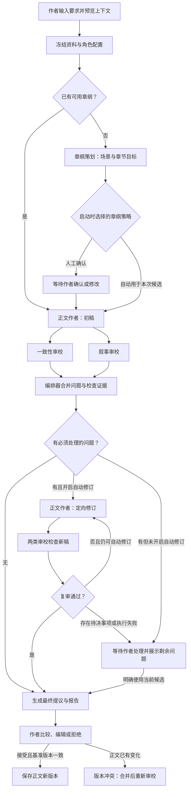

# 多 Agent 小说创作工作流方案

> 2026-11-05 更新：已清理旧的调用、轮次、期限与修订次数限额。自动修订采用开关，启用后持续修订并复审；模型上下文容量与队列容量仍按现有实现校验。当前能力以 [MA 实施说明](./MA-多Agent工作流实施.md)为准；依赖编译、审校屏障、产物失效和故障恢复的后续设计见 [多 Agent 编排完善设计](./多Agent编排完善设计.md)，其中新增字段与行为均待实现。

日期：2026-11-03；修订：2026-11-05  
状态：首版已实施，包含用户自定义 Agent；实际交付、接口及限制见[实施说明](./MA-多Agent工作流实施.md)。本文同时保留后续扩展设计。  
适用项目：灵码 · AI 小说写作工作台

2026-11-05 更新：实现与验证范围见[通用编排与流程画布实施](./MA-通用编排与流程画布实施.md)。需求扩展：编排升级为正文、世界观与大纲共用的任务执行能力，支持在助手输入区选择模板直接运行。近期产品范围以 [通用创作编排与助手入口设计](./通用创作编排与助手入口设计.md)为准；本文第一版的章节目标及阶段限制仅描述已交付单章路径。

## 1. 方案结论与范围

在现有单 Agent 能力之上增加持久化工作流：由确定性的编排器安排任务，让不同职责的 Agent 分别策划、写作和审校，通过版本化产物交接，最终由作者确认入稿。

第一版建议交付“单章协作写作”：

> 创作要求 → 资料准备 → 章纲策划 → 正文初稿 → 一致性与叙事审校 → 必要时定向修订并复审 → 作者确认 → 正式正文新版本。

这里的多 Agent 是独立的任务提示词、上下文、工具权限和产物契约；不同角色可以使用同一个模型，也可以分别指定模型。Agent 由用户在角色库中创建和管理，四种内置角色作为可复制的预设，角色名称和数量不写死。第一版在同一进程内执行，保留全局同时运行一个模型任务的限制。

### 1.1 创作模板

| 模板           | 输入                                   | 主要交付物                               | 建议阶段       |
| -------------- | -------------------------------------- | ---------------------------------------- | -------------- |
| 单章协作写作   | 当前作品资料、章纲或创作要求、目标章节 | 章纲草案、正文候选、审校报告             | 第一版         |
| 世界观构建与审校 | 创意、已填写要素、指定世界观或新建目标 | 结构化世界观候选、规则审校与修订 | 通用化近期设计 |
| 故事总纲与事件规划 | 创意、世界观、人物、总纲及规划范围 | 总纲候选、有序事件/章纲、审校报告 | 通用化近期设计 |
| 创意到整书规划 | 题材、核心创意、篇幅、风格与禁区       | 故事设定、人物弧线、总纲、分卷与章节规划 | 后续扩展       |
| 按大纲连续写章 | 已确认总纲、章节范围、每章要求         | 逐章候选、审校报告、连续性资料           | 单章流程稳定后 |

第一版允许已有章纲时跳过策划。没有章纲时，由策划 Agent 生成并暂停，供作者确认后继续；可在启动时选择“章纲自动用于本次候选”，减少中途操作。上述选择只影响候选流程，正式入稿始终由作者确认。

### 1.2 第一版边界

- 复用 TypeScript、pnpm Workspace、现有 pi-ai 适配、自研循环、SQLite 和 SSE。
- 第一版交付可自定义 Agent 的角色库，以及阶段列表形式的工作流配置：替换策划、写作和修订角色，增删审校节点，在指定位置插入辅助节点；自由拖拽、任意分支和自定义脚本留到后续。
- 每次面向一个已有目标章节，支持完整单章写作；选区改写继续使用现有单 Agent 入口。
- Agent 可读取授权作品资料、指定 Skill 和上游产物；不提供 shell、任意网络访问或自主启动其他 Agent 的工具。
- 不自动更改正式人物、世界观、总纲和正文；候选中的新设定也不立即成为正式事实。
- 第一版不新增外部编排框架或服务。本文技术选择基于现有仓库能力，不涉及外部框架版本比较。

## 2. 首版建设基础与改造记录

本节保留 2026-11-03 启动 MA 前的能力对照；表中“新增”多已在首版交付，不表示仍未实现。当前差距见编排完善设计第 2 节，当前接口见 MA 实施说明。

| 领域       | 现有能力                                  | 本方案新增                               |
| ---------- | ----------------------------------------- | ---------------------------------------- |
| Agent 执行 | `runLoop`、动作注册表、检查点、取消与用量统计 | 用户角色库、能力契约、结构化产物提交动作 |
| 模型       | 模型配置与 pi-ai 适配                     | 按角色选择配置并冻结到工作流快照         |
| 上下文     | 文档版本授权、引用、Skill 按需读取        | 上游产物授权、角色隔离、设定状态区分     |
| 运行       | 持久化 runs、单任务队列、SSE              | 工作流、节点、执行尝试与聚合事件         |
| 提议       | 基准版本检查、幂等接受、历史版本          | 只将最终稿转为一个正文提议               |
| 提示词     | 全局 Agent 提示词                         | 工作流及角色提示词版本；不覆盖全局提示词 |

首版改造时明确的边界：

1. `WritingService` 当前负责全局单任务调度，不能再启动一个独立的工作流模型队列，否则会突破并发限制。
2. `WritingStore` 与数据库都限制同作品写作任务及同会话活跃任务。工作流内部必须通过父任务授权顺序创建子运行，不能简单把多角色请求塞进当前聊天会话。
3. 现有动作名称、结果与注册表是固定 schema。提交工作流产物需要扩展 shared schema 与动作注册，不能仅在提示词中发明工具。
4. 现有输入、上下文 hash、记录器与终态处理面向单次写作。工作流子运行需要增加受控的角色和产物快照入口。
5. 现有检查点只代表单 Agent 完整轮次；工作流还需记录节点依赖、具体稿件版本和人工决策。

## 3. 可扩展 Agent 角色库

第一版预置四种 Agent 角色，用户可以复制修改，也可以从空白创建。默认修订复用正文作者角色，用户也可以指定独立修订角色。编排器按已发布的工作流配置执行，不通过模型自由分派任务。

| 角色             | 任务                                               | 输入                                                 | 结构化输出                    | 权限                             |
| ---------------- | -------------------------------------------------- | ---------------------------------------------------- | ----------------------------- | -------------------------------- |
| 章纲策划 Agent   | 将创作要求转为可执行场景安排                       | 已确认设定、总纲、前章承接、作者要求                 | `chapter_plan`                | 读取资料，提交章纲草案           |
| 正文作者 Agent   | 根据章纲创作；根据指定问题修订                     | 已确认或本次允许使用的章纲、人物、相关前文、风格约束 | `chapter_draft`               | 读取资料及授权产物，提交正文候选 |
| 一致性审校 Agent | 检查时间线、人物状态、知识边界、设定、伏笔与因果   | 当前候选、章纲、授权事实资料                         | `review_report`（一致性领域） | 只读，提交问题与证据             |
| 叙事审校 Agent   | 检查视角、场景目标、人物动机、节奏、语言与章节承接 | 当前候选、章纲、作者偏好                             | `review_report`（叙事领域）   | 只读，提交问题与建议             |

用户可新增“悬疑伏笔审校”“感情线审校”“对白润色”“历史背景顾问”等角色并接入流程。后续提供“设定整理 Agent”预设及其接受后触发流程：从已接受的正文提取章节摘要、人物状态变化与伏笔更新建议。它输出待确认资料，既不重写正文，也不凭候选修改正式设定。

### 3.1 角色提示词组织

提示词按“应用约束 → 本次全局提示词快照 → 角色任务 → 作者要求 → 资料与产物”组织。读取内容被明确标为资料，其中文字不能改变运行权限。

每个角色配置保存角色标识、提示词版本、模型配置、Skill 版本集合、允许动作。应用约束由服务端实现并校验；作者自定义角色提示词不能授予额外工具或正式文档写权限。

Skill 是角色使用的方法与参考资料，不承担工作流节点状态。启动预览列出每个角色可加载的 Skill 版本，候选运行后不随 Skill 更新而漂移。

### 3.2 用户可自定义的内容

| 配置项       | 用户操作                                                 | 执行规则                                               |
| ------------ | -------------------------------------------------------- | ------------------------------------------------------ |
| 基本信息     | 名称、介绍、标签；从空白创建或复制预设                   | 名称只是展示字段，调度使用稳定 ID                      |
| 职责与提示词 | 编写任务要求、风格、检查清单、示例                       | 系统补入输入输出契约；资料内容不变成指令               |
| 模型         | 选择已有供应商配置、模型及允许的生成参数                 | 使用已有凭据管理；角色不存明文密钥                     |
| Skill        | 选择角色可使用的 Skill                                   | 发布版本固定 Skill 版本，启动时展示                    |
| 能力类型     | 策划、正文生成或修订、审校、辅助分析                     | 决定可绑定的节点和产物契约                             |
| 上下文偏好   | 人物、总纲、近章、世界观、指定资料及上游产物             | 是资料选择规则；实际范围与本次作品授权取交集           |
| 工具权限     | 从系统已注册的能力中勾选读取、检索、Skill 加载、产物提交 | 有效权限取系统允许、角色声明、节点要求与本次授权的交集 |
| 执行策略     | 模板控制是否自动修订；模型输出沿用模型配置               | 不设角色独立轮次、执行期限或调用次数限额               |

角色库支持新建、编辑草稿、发布版本、复制、归档和试运行。试运行使用用户选择的作品资料或合成样本，产生独立测试产物，不创建正式文档提议；发起前展示将调用的模型与上下文。

角色定义默认保存在当前独立实例，可在不同作品复用；具体资料在作品启动时绑定，不把某作品人物和全文固化进公共角色默认配置。

### 3.3 Agent、节点与产物契约

- **Agent 定义**回答“谁来做、如何做”：提示词、模型、Skill、资料偏好和能力。
- **工作流节点**回答“何时做、对什么做”：依赖、输入映射、绑定的 Agent 版本、输出用途及是否必须完成。
- **产物契约**回答“交付什么”：服务端可校验的数据结构，供下一节点稳定读取。

同一个 Agent 可在多个节点使用，例如同一作者先写初稿再修订；同一种审校节点也可以绑定不同 Agent。节点绑定具体 `agentProfileVersionId`，不按名称查找角色。

| 能力类型   | 允许输出             | 可接入位置                                       |
| ---------- | -------------------- | ------------------------------------------------ |
| `plan`     | `chapter_plan`       | 策划阶段                                         |
| `draft`    | `chapter_draft`      | 初稿、修订或顺序润色阶段                         |
| `review`   | 通用 `review_report` | 任意审校节点，按领域标识区分一致性、叙事、悬疑等 |
| `analysis` | `analysis_note`      | 写作前或审校汇总后，作为建议供下游参考           |

内置一致性与叙事审校共用 `review_report`，分别声明 `domain=continuity/narrative`；用户审校角色可设置领域标签，问题严重程度和引用结构保持统一。辅助分析使用固定的标题、正文、来源引用与待决事项结构，不以任意自由文本直接驱动分支判断。

用户第一版无需编写 JSON Schema。输入输出由所选能力类型确定，服务端使用预置 Zod schema；新增底层工具或新的产物结构属于开发扩展，需要注册实现、schema 和迁移，导入提示词不能执行代码。

当前模板校验能力兼容、节点键唯一、阶段顺序和必需审校，预览校验模型上下文容量；显式输入来源、通用依赖无环与输出归属检查属于后续编译计划。正式提议只能来自选定的最后一份 `chapter_draft`，辅助分析不能冒充正文或审校结论。

### 3.4 版本与生命周期

Agent 使用“稳定定义 ID + 不可变发布版本”。编辑先保存草稿，发布后生成新版本；工作流模板也保留版本，并绑定发布的 Agent 版本。更新 Agent 时列出受影响模板，由用户选择升级后发布模板新版本，已有运行沿用原快照。

内置预设可以复制后自由修改；内置预设更新不覆盖用户角色。已引用的角色允许归档，历史版本与运行记录继续可读；新模板不能选择已归档角色。模板已绑定但角色后来归档时，启动检查提示替换，正在执行或中断后恢复的运行仍使用原版本。

同名角色通过稳定 ID 区分；删除或更新模型配置、Skill 等依赖时，阻止破坏历史读取，启动及恢复前检查实际可用性。凭据失效时等待用户修复，不静默切换模型。

## 4. 工作流与人工控制



图示为默认模板。用户可替换各节点 Agent、增加其他审校节点，并将修订交给独立 Agent。审校在依赖上独立，第一版由同一调度器依次执行；配置为必须完成的审校报告齐备后才做下一步决策。

### 4.1 用户配置工作流

当前阶段列表提供添加节点、选择 Agent、调整顺序和必需标记；模板配置章纲确认及自动修订开关。输入来源由阶段顺序派生，尚未提供逐节点输入映射、任意人工确认点或通用依赖图编辑；这些扩展按编排完善设计实施。

- 策划阶段可以使用已有章纲或选择一个 `plan` Agent。
- 正文阶段至少有一个 `draft` 节点；可增加顺序润色节点，每个节点明确接收上一稿并输出新稿。
- 审校阶段支持多个 `review` 节点，可配置必须完成或仅供参考；第一版至少保留一个必须完成的审校节点，默认包含一致性和叙事两项。
- 修订阶段可以复用作者或绑定另一个 `draft` Agent；复审覆盖所有必须完成的审校节点，是否自动持续修订由模板开关控制，不设修订次数上限。
- 辅助分析节点可放在写作前或审校汇总后；用户明确选择哪些下游可读取其结果。若分析意见要自动阻止流程，应改用审校能力并提交标准问题结构。
- 最终确认节点由系统提供，始终保留。引用正文的任何下游报告，在正文经过润色或修订后都需要重新生成。

例如用户创建“对白润色师”（`draft`）和“伏笔审校员”（`review`），即可配置“策划→作者初稿→对白润色→一致性/叙事/伏笔审校→定向修订→全部必需复审→作者确认”。增加角色后启动预览重新展示节点安排、模型及上下文占用；实际调用数随工具执行和修订变化。

### 4.2 各阶段行为

1. **资料准备**：先保存目标章节草稿；冻结正文基准版本、授权资料版本、角色配置与模板版本。缺少关键人物或固定输入超出模型上下文容量时，在模型调用前提示作者处理。
2. **章纲策划**：交付章节目标、视角、起止状态、场景列表、冲突升级、伏笔安排与篇幅建议。缺失事实写为待决事项，不把推测写成正式设定。
3. **正文写作**：产出完整 Markdown 正文及简短创作说明；未完成或截断的输出保存为片段，不进入审校与提议阶段。
4. **独立审校**：所有审校者读取同一 `draftArtifactId`；第一轮不读取其他审校者结论，避免意见相互诱导。
5. **问题汇总**：编排器根据证据和严重程度决定继续、修订或等待作者，不能仅凭模型的“通过”文本决定。
6. **定向修订**：修订者收到待修问题、不可变要求及原稿，尽量保留未受影响段落。新稿为新产物，旧稿可比较。
7. **复审**：所有必须完成的审校节点审阅新稿，检查原问题是否解决和是否出现新问题；旧报告保留但不作为新稿通过依据。参考审校也重新运行；失败可跳过，旧稿报告不能充当本轮结论。
8. **作者确认**：展示最终稿、与原文差异、已解决与剩余问题、用量；作者接受后才新增正式版本。

### 4.3 审校问题与裁决规则

本节包含目标规则。当前实现校验稿件引句、来源归属与范围，并按 P0/P1 和未覆盖项推进；跨轮稳定问题身份、证据语义裁决、去重与互斥意见识别尚未实现，不能把下述目标当作自动质量保证。

| 等级 | 含义                           | 示例                                                     | 默认处理                   |
| ---- | ------------------------------ | -------------------------------------------------------- | -------------------------- |
| P0   | 有证据的硬约束冲突或正文不完整 | 已死亡人物无解释出场；指定限知视角写出未知秘密；全文截断 | 阻止自动进入最终提议       |
| P1   | 明显影响本章目标或阅读理解     | 场景缺少转折；关键行动缺乏动机                           | 进入定向修订               |
| P2   | 可选风格建议                   | 修辞重复；局部节奏可更紧凑                               | 展示给作者，不单独触发修订 |

每条问题包括：稳定问题 ID、审校角色、严重程度、问题类别、所在稿件与段落锚点、候选原文引句、资料引用、说明与建议。叙事问题可引用章纲目标或作者要求，不强制伪造外部证据。

- 当前服务端验证候选引句存在、资料引用属于授权版本且范围合法；不能证明资料支持问题结论。越权或无效引用会使提交失败。“待核实”状态与更完整的证据定位属于后续设计。
- 只有“未发现问题”但缺少审查范围说明的报告不视为有效完整报告；报告必须明确已检查项目、未覆盖项目和结论。
- 重复意见按类别与位置聚合，但保留原始问题；第一版不增加模型裁判调用。
- 涉及作者意图、未定义设定或多份建议互斥时，暂停并展示可选择的处理方式。无法机械判断文学取舍时，不用投票代替作者决定。
- 初稿后如有 P0/P1 或必需审校未覆盖项，且配置修订节点并开启自动修订，则持续修订并复审，不设固定次数上限。关闭自动修订或缺少修订节点时等待作者；节点失败需重试，关键事实与文学取舍由作者决定。后续拟增加无有效变化检测与问题跟踪，见编排完善设计，不将其描述为当前已具备的能力。
- 参考审校不因失败或缺失单独阻塞流程，但它已发布且经校验的 P0/P1 同样纳入问题汇总，不能通过改成“参考”静默忽略已发现的问题。
- 作者可以明确接受带问题的完整稿，必须保留所见报告和覆盖决定；不完整稿、无效产物和版本冲突不能通过此方式直接入稿。

## 5. 产物与长期资料

### 5.1 产物契约

所有产物不可变；修改产生新 ID。模型只提交业务字段，身份、权限和时间由服务端填入。下表是目标设计，当前包络与 payload 以 `packages/shared/src/workflows.ts` 和 `workflow-artifacts.ts` 为准；`supersedesArtifactId`、独立决策产物和长期记忆提议尚未实现。

| 产物                   | 核心字段                                                                                                                                                       |
| ---------------------- | -------------------------------------------------------------------------------------------------------------------------------------------------------------- |
| 通用包络               | `id`、`schemaVersion`、`workflowId`、`nodeId`、`attemptId`、`type`、`contentHash`、`inputArtifactIds`、`sourceVersionIds`、`supersedesArtifactId`、`createdAt` |
| `chapter_plan`         | 章节目标、视角、场景、冲突、人物状态边界、伏笔计划、篇幅要求、待决事项                                                                                         |
| `chapter_draft`        | 完整正文、章纲产物引用、修复的问题 ID、修订说明                                                                                                                |
| `review_report`        | `domain`、`reviewedArtifactId`、检查范围、问题集合、未覆盖项、结论；审校 Agent 身份由服务端关联                                                                |
| `analysis_note`        | 标题、正文、来源引用、待决事项；供明确指定的下游参考                                                                                                           |
| `decision_record`      | 作者确认内容、允许继续的产物、覆盖的问题、决策时版本与时间                                                                                                     |
| 后续 `memory_proposal` | 已接受正文版本、章节摘要、人物状态变化、伏笔变化、原文证据                                                                                                     |

以 `submit_workflow_artifact` 作为新增固定动作提交结构化产物，正文通过正文字符串字段提交。共享 Zod schema 校验格式，服务端按 Agent 能力与节点契约校验允许的产物类型、引用与归属；不同领域审校共用 `review_report` 契约。

模型的一轮提交先进入暂存；完整轮次提交后标为 committed，节点正常结束后才发布产物。只有整个节点正常结束、必需产物完整且验证通过，编排器才将节点标为成功。流式展示、模型自称完成、暂存工具结果均不能触发下游。

### 5.2 资料状态与上下文

资料分为四类：

1. **正式事实**：作者已保存或接受的设定、人物资料和正文版本。
2. **规划事实**：作者认可的后续计划，附明确“尚未发生”标记。
3. **本次候选**：当前工作流的章纲与正文，允许下游加工，但不视为正式历史。
4. **待决事项**：缺失信息、角色推测、新增设定与相互冲突的要求。

角色通过独立上下文包读取所需资料；不共享无限增长的聊天记录。写作者通常需要章纲、相关人物、近章承接和风格约束；一致性审校需要可追溯事实；叙事审校需要目标、正文和偏好。

正文与来源全文按需读取，超出模型上下文容量时先提示缩小范围或调整配置。检索只在授权版本集合中进行。摘要是辅助索引，发生冲突时回查原文，不能覆盖原文事实。

上下文 hash 覆盖资料版本、上游产物 hash、全局及角色提示词版本、Skill 版本、模型配置和模板配置。工作流创建时冻结外部输入；每个节点派生自己的可复查快照。当前刷新资料会重新执行 preview，可能同时读取最新模型配置及全局提示词；将资料刷新与执行配置升级分离属于后续改进。

## 6. 执行架构与状态

### 6.1 模块边界

```text
apps/web                    角色库、工作流配置、阶段进度、产物比较、人工决策
    ↓ HTTP / SSE
apps/server/workflows       角色版本、模板校验、持久化状态机、决策与产物
    ↓ 受控创建子运行
apps/server/writing         唯一模型任务调度、上下文、动作实现与记录器
    ↓
packages/agent              复用 runLoop、模型适配和动作执行
packages/shared             角色、工作流、产物、API 与事件 schema
```

编排器负责决定“哪个节点就绪”；现有执行队列负责“哪个模型任务开始”。第一版不增加新的公开包，不把数据库和小说业务移入 `packages/agent`。

### 6.2 数据持久化

| 目标表或关联                                        | 职责                                                                                      |
| --------------------------------------------------- | ----------------------------------------------------------------------------------------- |
| `agent_profiles` / `agent_profile_versions`         | 角色稳定身份、可编辑草稿、归档状态及不可变发布配置；版本保存能力、模型、Skill 与工具 |
| `workflow_templates` / `workflow_template_versions` | 模板身份及发布版本，保存节点依赖、输入映射、审校策略和绑定的 Agent 版本                   |
| `workflow_runs`                                     | 作品、目标、基准版本、模板与配置快照、状态、用量及修订计数                                |
| `workflow_nodes`                                    | 节点依赖、Agent 版本、能力契约、当前状态、当前执行尝试、所选输出                          |
| `workflow_node_attempts`                            | 每次尝试对应一个独立 run，保存输入 hash 与失败原因                                        |
| `workflow_artifacts`                                | 暂存与已发布的不可变产物、hash 和来源关系                                                 |
| `workflow_decisions`                                | 作者确认、反馈、问题覆盖决定与版本                                                        |
| `workflow_events`                                   | 工作流级单调序号事件，支持 SSE 重连                                                       |
| `project_activity`                                  | 同作品写作占用，标识普通写作或父工作流及其 owner ID                                       |

上表包含后续结构：当前节点保存在 `workflow_runs.state_json`，没有独立 `workflow_nodes` 或 `project_activity` 表；作品占用由工作流唯一索引与普通写作事务检查实现。

通过新增迁移扩展 `runs` 的工作流关联字段或独立一对一关联表；不修改已应用迁移。`purpose` 继续表示 write/rewrite/review 等写作用途，另用关联区分工作流子运行。节点角色不能借用 `skill_test` 绕过权限。

子运行的创建、attempt 关联和节点排队状态在一个事务中落库，并设置唯一约束，避免同节点被重复领取。同样，子运行终态、有效产物选择、节点转换和工作流事件须能原子提交或通过幂等对账补齐。

工作流子运行沿用既有记录器保存轮次、工具结果和可见输出。旧聊天界面继续能使用普通运行；工作流产物不自动触发旧的候选提议生成逻辑，最终提议由工作流发布操作显式创建。

### 6.3 状态语义

工作流状态：`queued → running → awaiting_input / awaiting_acceptance → completed`，另有 `paused`、`failed`、`limited`、`cancelled`、`interrupted`。

- `awaiting_input`：需要作者确认章纲、处理审校分歧、未解决问题或版本变化。
- `awaiting_acceptance`：最终提议与报告齐备，等待接受或拒绝。
- `completed`：最终提议被接受，或作者明确拒绝并结束；用 `outcome=accepted/rejected` 区分结果。
- 节点状态单独记录 `pending/queued/running/succeeded/failed/limited/cancelled/interrupted/skipped/invalidated`，不复用“作者已接受”含义。

进程启动时先修复既有 runs，再对账父工作流；遗留活跃工作流标为 `interrupted`，不静默重新调用模型。作者点击继续后，从可验证的节点边界或既有完整轮次检查点恢复。

模型请求的远端处理结果可能在崩溃时未知，无法保证远端计费恰好一次。系统保证本地节点领取、产物发布与正式提议接受幂等，并展示重试可能重复产生模型用量。

### 6.4 暂停、取消、重跑与版本变化

- **暂停**：设置持久化标记，当前节点完成后停在边界；需要立即停止时使用取消。
- **取消**：阻止新节点排队，取消已排队子运行并向当前子运行传递 AbortSignal，保留已产生的完整产物和用量。
- **节点重试**：沿用冻结输入和角色配置，新建 attempt；已成功的上游不重复调用。
- **修改后重跑**：修改章纲或正文形成新产物，所有依赖旧产物的下游节点失效；重跑时重新验证上下文容量与作者授权；任意节点重跑及通用下游失效尚待实现。
- **目标章节变化**：允许作者正常手写；接受提议时检查原基准版本。需要合并则生成新候选并重新审校，不覆盖新正文。
- **其他资料变化**：本次任务仍基于快照；提交前显示引用资料是否已更新，要求作者选择沿用快照或刷新并重跑相关节点。
- **角色配置变化**：运行中的任务不随配置变化；当前需结束后新建流程才能主动切换配置；资料刷新会重新生成预览，配置可能一并更新，后续需拆开此行为并保留原记录。

### 6.5 并发、上下文与用量

第一版共用现有全局单模型队列，模型执行并发为 1，活跃运行队列上限 32。一个父工作流占用同作品 AI 写作资源，子运行按 owner ID 受控进入；普通写作与父工作流在数据库事务内检查占用。人工编辑不受此占用限制。

等待人工决策时保留作品写作占用，界面提供“结束流程”释放；不占用模型执行槽。未就绪节点不提前进入队列。各审校节点用独立子运行，不复用受唯一活跃约束的聊天会话。

| 项目 | 当前规则 |
| --- | --- |
| 自动修订 | 模板 autoRevise 控制；启用且存在修订节点时持续修订并复审，无固定次数上限 |
| 格式修复 | 必需节点正常结束但未提交产物时，全流程自动补救一次；不代替内容修订 |
| 轮次、调用与期限 | 不设置角色轮次、工作流总调用次数或执行期限限额；调用和耗时用于统计 |
| 模型输出 | 沿用选定模型配置，不设置角色独立输出上限 |
| 上下文容量 | 预览和节点组装后校验，仍受模型窗口、输出预留和估算余量约束 |
| 费用 | Token 和费用累计记录，未知保持未知，不同币种分别统计；不提供金额硬预算 |

节点数不能当作请求数或费用：节点可能多轮读工具，失败、取消和格式修复也可能产生用量。模型调用统计不承诺等于供应商底层 HTTP 尝试数，重启或取消后远端是否计费可能未知。持续修订下的输入膨胀、无有效变化和调度公平性按编排完善设计分阶段改进。

## 7. API 与界面

### 7.1 接口与事件

当前接口以 MA 实施说明为准。创建、发布、试运行和工作流决策使用幂等键；配置修改和决策使用 expectedRevision。核心编排接口如下，前缀均为 /api/v1：

| 方法与路径 | 用途 |
| --- | --- |
| POST /workflow-previews | 预览角色、模型、授权资料与上下文占用，返回 hash |
| POST /workflows | 创建父流程；当前 expectedPreviewHash 可选，后续拟收紧 |
| GET /workflows/:id | 状态、节点、产物、问题与用量 |
| POST /workflows/:id/decisions | 确认章纲、反馈、编辑候选、选择候选、暂停、恢复、重试、取消和拒绝 |
| POST /workflows/:id/refresh-sources | 刷新资料；正文基准变化时提交完整合并稿并复审 |
| GET /workflows/:id/events | SSE；按 Last-Event-ID 重放并补读快照 |

暂停、恢复、取消和重试都通过 decisions 的 action 执行，没有独立控制端点或任意节点 rerun API。后续依赖、问题裁决和指定起点重跑的字段与兼容策略见编排完善设计，不将设计字段直接写入当前严格 schema。

正文最终接受与拒绝复用现有提议 API，事务内同步工作流结局。工作流子运行禁止从普通运行重试接口单独重试，避免脱离父状态机；历史详情仍可通过关联 run 查询。

工作流 SSE 使用 change 承载带序号的状态事件，如 node.started、artifact.published、workflow.awaiting_input 和 workflow.finished。子运行流式输出按 run ID 查询和订阅；总览不复制每个 Token。review.aggregated 等新增事件尚待实现。

### 7.2 作者使用流程

当前从左侧导航进入角色库、工作流模板或作品内协作写作独立页面，具体导航以 NAV 实施说明为准。

1. 在“Agent 角色库”中创建角色或复制预设，设置提示词、模型、Skill、能力、上下文偏好；可试运行后发布。
2. 选择或复制单章模板，为阶段绑定角色，增删审校、插入润色或辅助分析节点，保存并发布模板版本。
3. 选择目标章节、目标字数、风格、必写内容和禁止事项。
4. 预览每个节点实际使用的角色版本、模型、资料范围、章纲确认策略、自动修订开关与上下文占用，然后启动。
5. 查看阶段列表，每个阶段展示角色、状态、完整产物、问题与用量；可进入原运行详情。
6. 在需要输入时看到具体待决事项，提交反馈或编辑产物后继续。
7. 最后比较原文与最终候选，查看未解决问题，接受、编辑后复审或拒绝。

第一版用阶段列表表达流程。用户使用路径展示“正在写作”“等待确认”等状态；数据库表名、节点 hash 和调度细节仅在运行详情中提供。

## 8. 示例：写第十二章《雨夜来客》

作者要求：第三人称限知；约 3000 字；主角发现来客说谎；结尾留下印章线索；来客此时不能知道密室位置。

| 阶段       | 产物与系统行为                                                        |
| ---------- | --------------------------------------------------------------------- |
| 策划       | 安排“进门试探→交换信息→发现破绽→来客离开”四个场景；将印章作为结尾线索 |
| 作者确认   | 调整为“主角只产生怀疑，不当场揭穿”，确认章纲                          |
| 初稿       | 生成候选 D1，保留正式正文原版本                                       |
| 一致性审校 | 指出来客说出密室方位，引用人物知识边界资料，标记 P0                   |
| 叙事审校   | 指出交换信息场景重复、疑点暴露过早，标记 P1                           |
| 修订       | 删除越界信息，合并重复对话，将怀疑改为动作细节，产出 D2               |
| 复审       | 两类报告都引用 D2；原问题解决，保留一个 P2 语言建议                   |
| 最终确认   | 作者查看 D1/D2 与原文差异，接受 D2，新增正式正文版本                  |

后续设定整理只基于已接受版本提出“主角开始怀疑来客”“印章伏笔已出现”等更新，不能将未入稿的 D1 情节记入作品事实。

## 9. 实施拆分与验收

本文不调整原 P06/P07 的排期；多 Agent 作为独立 MA 系列增量，实施时同步实施基线与契约。

| 阶段                | 交付                                                             | 验收标准                                                                         |
| ------------------- | ---------------------------------------------------------------- | -------------------------------------------------------------------------------- |
| MA1：契约与最小编排 | shared schema、新迁移、角色与模板版本、父子运行与产物提交        | Fake 模型完成默认流程；用户新增审校角色可通过同一执行接口运行；无正文自动写入    |
| MA2：完整单章流程   | 可配置节点、兼容性校验、策划确认、问题合并、修订复审、上下文与占用 | 默认及新增“对白润色/伏笔审校”模板跑通；超出模型上下文容量时提示处理；旧稿旧报告完整保留          |
| MA3：作者工作台     | 角色库编辑/试运行/发布、阶段配置、反馈、候选编辑、差异与 SSE     | 用户无需改代码即可创建角色并接入流程；刷新与断线后还原状态；接受和冲突处理可完成 |
| MA4：故障与质量验收 | 恢复对账、取消竞态、幂等、回归与人工样本评阅                     | 满足下述工程验收；明确真实模型质量与费用验证范围                                 |
| MA5：后续扩展       | 接受后资料整理、整书规划、连续章节、可配置审校并发               | 前章接受及资料确认后再推进下一章，避免候选事实串入后章                           |

### 9.1 必须覆盖的工程场景

- 下游只能消费已成功发布且 hash 匹配的产物；审校旧稿不能让新稿通过。
- 用户创建不同名称的审校 Agent 即可增加审校节点，不修改硬编码角色枚举；错误能力绑定、缺失输入、非法顺序和固定输入超出模型窗口在启动前拒绝；通用依赖图校验属于后续编排设计。
- 修改或归档角色、升级 Skill、更新模板都不改变已有运行；发布存在版本冲突时保留用户草稿并要求合并。
- 角色请求的资料和工具权限不能超出节点及本次授权；角色试运行不能生成正式文档提议。
- 无效 JSON、错类型、越权引用、超长产物、输出截断均不会变成正式提议。
- 审校冲突、未知事实、缺失报告、修订后仍有问题都进入明确的等待或失败状态。
- 两次请求重复创建、重复节点领取、重复事件投递和重复接受不会重复写稿。
- 子运行结束与父状态转换之间崩溃、产物暂存后崩溃，启动对账能确定下一步。
- 取消与完成同时发生、停止后重启、重试与暂停同时发生，不会越过父状态与输入有效性检查启动新节点。
- 同作品普通写作与工作流互斥；不同作品等待公平；人工等待不占模型槽。
- 作者中途改正文、更新人物资料、修改章纲或提示词，都保留正确版本与失效关系。
- SSE 重连、事件历史被裁剪时能够重新取快照，不把残缺流式内容当作最终稿。
- 现有单 Agent 写作、Skill 管理、导入导出及历史恢复保持可用。

验证分三层：编排器与事务测试；真实 pi-ai SDK 配本地模拟供应商的集成测试；Playwright 工作流全路径。真实供应商测试需使用已配置模型，单独报告实际用量与费用，离线测试不替代真实创作质量验证。

### 9.2 创作质量验收

使用同一批冻结资料和创作要求，比较现有单 Agent 与多 Agent 候选，由作者按人物一致性、因果与时间线、章纲完成度、叙事可读性、文风贴合、修改耗时进行盲评，并记录模型调用数、Token、耗时与可知费用。

先建立小规模样本，至少覆盖普通续写、人物知识边界、跨章时间线、文风约束与审校意见冲突。工程验收与文学质量分开记录；不能将“自动审校通过率”直接解释为作品质量提高。质量阈值与可接受成本在样本评阅后由主人确定。

## 10. 评审关注点

已纳入主人要求：Agent 可扩展，用户可从空白创建、复制修改并接入工作流；角色数和角色名称不写死，模型、提示词、Skill 与权限可配置。

当前方向为“单章协作、四个默认预设、可自定义角色与节点、可开关持续修订、最终人工入稿”。以下仍属后续产品选择：

1. 单章闭环完善后，优先整书规划还是连续多章存稿。
2. 章纲确认已由 confirmPlan 配置；后续是否增加按模板或作品记忆偏好。
3. 后续是否扩展角色配置导入导出、跨实例共享，以及自由拖拽与任意条件分支；第一版已包含角色独立模型与 Skill 配置。
4. 作者可以接受的每章耗时、实际调用量及成本范围，需要样本实测后设定。

MA1—MA4 的首版单章闭环已交付；通用编排已接入助手选择、世界观与大纲任务，并支持可视化流程画布与依赖输入隔离，见[实施说明](./MA-通用编排与流程画布实施.md)。后续继续补齐独立审校批次、失效传播和问题生命周期。用真实写作样本验证收益后，再扩展整书连续自动写作。
