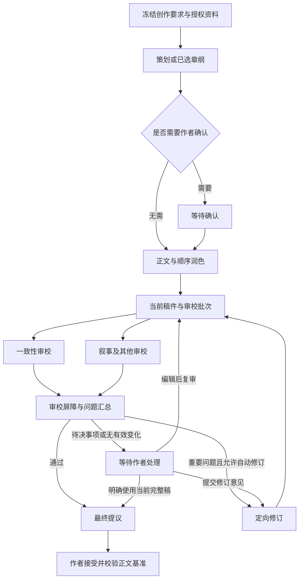

# 多 Agent 编排完善设计

日期：2026-11-05  
状态：可靠性目标设计。显式依赖、输入隔离、无变化检测及通用编排/流程画布已部分实现，准确范围见[本轮实施说明](./MA-通用编排与流程画布实施.md)；其余建议契约仍待实现。  
关联：[工作流方案](./多Agent小说创作工作流方案.md)、[MA 实施说明](./MA-多Agent工作流实施.md)、[实施基线与契约](./实施基线与契约.md)。

同日需求调整：主人要求编排通用化，在写作助手选择模板运行，并支持世界观和大纲生成。产品入口、通用任务及保存适配器以 [通用创作编排与助手入口设计](./通用创作编排与助手入口设计.md)为准；本文保留依赖、血缘、审校和恢复机制，单章字段作为现有实现与示例，不再限定新编排的业务范围。

## 1. 目标与约束

在现有单章协作上形成可复用的编排核心，补齐“输入来自哪里、何时可以推进、变更后哪些结果仍有效、异常后从哪里恢复”，并用于正文、世界观和大纲任务。继续由确定性编排器调度，Agent 只执行当前节点并提交产物。模型可以给出建议，不决定权限、状态转移或正式保存。

保持已有产品方向：用户自定义角色；模板选择 Agent 发布版本；最终正文由作者接受；全局模型执行并发 1、活跃队列容量 32；不恢复轮次、调用次数、执行期限、Token 消耗或自动修订次数限额。模型上下文容量、输出配置和数据结构大小约束仍然有效。

近期设计包含通用任务契约、助手选择与运行、世界观和大纲模板。角色库与模板页负责管理，助手直接启动并展示运行卡，原协作写作页保留历史与完整详情。不引入外部编排框架、多进程调度、Agent 自主派生任务、任意脚本条件。流程图编辑已进入本轮范围，条件表达式仍不支持。

## 2. 代码核对与差距

下表保留本轮开发前的静态核对作为差距基线，不能用于判断开发后的全部当前行为。已实现依赖与通用任务及测试以本轮实施说明为准。

| 核对位置 | 当前行为 | 后续完善 |
| --- | --- | --- |
| `packages/shared/src/workflows.ts` | 模板 2—16 个配置节点；最多一个策划、一个修订，正文在审校前，修订在最后；至少一个必需审校 | 将阶段列表编译成显式依赖与输入绑定；模板大小约束不限制实际修订轮数 |
| `apps/server/src/workflows/service.ts`：`advanceOne` | 找到列表中首个未成功或跳过的节点；动态追加修订和复审；必需审校未覆盖项也触发自动修订 | 增加完整的本轮审校屏障和结构化推进原因 |
| 同文件：`enqueue` | 传入最新章纲、最新正文和全部已有分析；修订额外获得当前稿审校报告；审校不读同轮其他报告 | 按节点消费输入；防止旧分析和持续累积的反馈进入不相关节点 |
| 同文件：`reviews` | 按 `reviewedArtifactId === latestDraftId` 筛选报告 | 同时验证审校批次、有效节点尝试与资料快照 |
| 同文件：`registry` | 校验能力、稿件 ID、候选引句、资料引用归属与范围；P0 要求来源或 `author` | 细分结构有效、证据可定位、语义待判断，补充问题身份与裁决记录 |
| 同文件：`refreshSources` | 保存旧快照、生成新候选并追加复审；调用 preview 重新读取配置 | 将资料刷新与模型、全局提示词升级分开；展示配置差异 |
| 同文件：`decide` 与启动恢复逻辑 | revision、幂等键、节点边界暂停、取消、显式恢复和已完成子运行认领 | 明确控制动作竞态优先级、恢复对账矩阵与迟到结果处置 |
| `packages/shared/src/workflow-artifacts.ts` | 四类 payload；问题有模型给出的 ID，但没有跨轮问题状态或替代关系 | 引入产物血缘、问题跟踪和范围明确的作者决定 |
| `apps/server/src/db/migrations/0008-workflows.sql`、`0009-agent-trial-versions.sql` | 节点保存在父工作流 JSON；尝试关联 runs；产物有 staged/committed/published | 按需新增迁移；不得假定已有独立节点表或作品占用表 |

本轮已加入 `dependsOn`、节点位置以及候选无变化且复审未通过时的人工等待；任意节点 rerun API、完整跨轮问题裁决仍未实现。本文后续其余新字段、原因码和事件仍为建议契约，不能直接发送到严格校验的 API。

## 3. 三层编排与运行身份

角色版本定义“谁执行”，模板版本定义“先后关系”，运行计划定义“本次具体消费哪些输入”。三者分别保存，不把业务状态塞进角色提示词。

| 层次 | 责任 | 不承担的责任 |
| --- | --- | --- |
| 模板编译 | 检查能力兼容、阶段合法、输入可达、必需审校齐备，生成不可变计划 | 不调用模型，不预先生成未来修订轮的节点 |
| 编排器 | 判断就绪、创建尝试、认领产物、审校汇总、失效传播、人工等待和恢复 | 不自行写正文，不按模型自由文本分支 |
| WritingService / runLoop | 唯一模型队列、工具执行、流式输出、检查点和取消信号 | 不绕过父流程启动下游或接受提议 |

建议区分以下身份，均由服务端生成：

- `stepKey`：模板中的稳定节点键，例如 `continuity`。
- `nodeInstanceId`：本次执行节点实例；修订复审生成新实例，不依赖解析 `-r2` 等后缀识别轮次。
- `attemptId`：节点的一次执行，关联唯一 `runId`；同输入重试产生新尝试。
- `reviewBatchId`：一份确定稿件、资料快照和审查要求对应的一批审校。
- `sourceSnapshotId` / `executionSnapshotId`：分别标识资料授权与执行配置；标识只用于追踪，凭据仍通过现有管理读取。

身份引用必须校验同一工作流归属。模板发布版本保持不可变；旧运行保留原计划，新设计不能原地改写历史。

## 4. 阶段列表编译为依赖计划

服务端显式化依赖，编辑器已改为流程画布并保留列表视图。审校在逻辑上互不依赖，在物理上仍依次共用模型槽。修订循环由编排器追加实例，单批计划自身保持无环。

### 4.1 输入绑定

| 阶段 | 必要输入 | 可选输入 | 输出 |
| --- | --- | --- | --- |
| 策划 | 创作要求、授权资料快照 | 选定参考分析、已有章纲 | `chapter_plan` |
| 初稿 | 创作要求、资料、已选章纲或明确无章纲策略 | 写作前分析 | `chapter_draft` |
| 顺序润色 | 明确的上一稿、不可变创作要求 | 章纲、指定风格分析 | 新 `chapter_draft` |
| 审校 | 同批 draft、章纲、资料、审查清单 | 明确授权的写作前分析 | `review_report` |
| 审校后分析 | 本批稿件及已完成的报告 | 作者反馈 | `analysis_note`，只能供后续修订参考 |
| 修订 | 当前稿、本批问题与未覆盖项、作者决定 | 明确指定的分析 | 新 `chapter_draft` |

报告汇总与提议发布是系统节点，不需要额外“总管 Agent”。新增模型裁判应单独评估收益，不作为默认依赖。

输入选择器在节点入队时解析为确切产物 ID、hash 与快照 ID，然后冻结。重试读取这份绑定，不再次解释“最新正文”。旧分析若依赖旧稿或旧资料，不得自动注入；需要重算或显式作为历史参考，并标注不可用作本轮通过证据。

首轮审校互相隔离。复审可读取自身上一轮问题及作者裁决，用于检查修复情况；不读取同批其他审校者的结论。反馈按适用节点或问题绑定，避免把所有历史自由文本无限追加到每个上下文。

### 4.2 就绪条件与编译失败

节点入队前同时满足：父流程允许运行、没有暂停或取消屏障、必要依赖成功且有效、输入归属和 hash 正确、人工确认已完成、资料授权及执行配置可用、完整输入能装入模型上下文。

发布和启动时拒绝：重复键、缺失生产者、前向引用、循环依赖、能力与输出不匹配、正文后仍覆盖旧稿的审校安排、缺少必需审校。分析不得通过引用本批报告再反向影响同批审校形成隐式环。

建议先约定只有 `review` 可选；策划如可省略，应由已选章纲或无章纲策略替代，正文和指定顺序润色不得通过 `required=false` 静默跳过。当前 schema 允许其他节点设置 required，但运行时仅可选审校失败会自动跳过，需在后续编译器中统一。

就绪检查通过后，在同一事务中创建 run、绑定尝试和更新节点状态；事务提交后唤醒现有队列。父流程不预占模型执行槽，也不提前排入尚未就绪的子任务。

## 5. 产物血缘与失效传播

旧单章兼容路径保留现有 payload 类型；通用任务另外注册世界观、总纲和事件产物，并将审校目标推广到类型化产物集合，具体以通用创作编排设计为准。相同的血缘与失效规则适用于结构化字段及条目集合，不能只比较正文字符串。服务端包络建议增加以下字段：

| 字段 | 用途 |
| --- | --- |
| `schemaVersion` | 区分包络结构版本，不能与数据库迁移版本混用 |
| `nodeInstanceId`、`attemptId` | 明确产物来自哪次执行 |
| `inputArtifactIds`、输入 hash | 保存实际消费关系，不能只保存模板依赖 |
| `sourceSnapshotId`、`executionSnapshotId` | 追踪事实依据与执行配置 |
| `supersedesArtifactId` | 作者编辑、合并或模型修订产生新产物，旧产物继续可读 |
| `createdBy` | 区分模型产物、作者编辑和系统复制，避免作者稿伪装成旧模型输出 |

发布边界保持 `staged → committed → published`：工具提交暂存，完整轮次提交后 committed，子运行正常完成且校验通过后由编排器发布。父流程已取消或该尝试已被替代时，迟到结果只保存历史，不发布给下游。

产物内容不变不代表证据相同。相同正文在不同资料快照下复审，仍需新批次；hash 用于校验和对比，不单独代替工作流、稿件 ID 与快照归属。

### 5.1 失效规则

1. 找到被替换输入的实际消费者，沿消费关系计算所有后继。
2. 保留旧节点、尝试、产物与事件，标记本次选择关系失效，不删除历史。
3. 撤销旧的待接受提议；已入稿的正式版本保持历史，只能通过新的编辑版本调整。
4. 为失效部分生成新实例；不受影响的上游保持成功，不重复调用模型。
5. 同一事务提交新当前产物、失效集合、提议处理与事件，之后才调度新节点。

| 变更 | 需要重算 | 可保留 |
| --- | --- | --- |
| 作者改候选正文 | 依赖该稿的分析、全部本轮审校与最终提议 | 已确认章纲、不依赖正文的分析 |
| 作者改章纲 | 消费该章纲的正文及后继；已有正文可显式选作修订起点 | 不依赖该章纲的资料准备结果 |
| 刷新人物或设定 | 消费旧快照的分析和报告；至少对完整候选复审，需改文则再修订 | 旧候选作为新批次起点，保留旧报告供比较 |
| 正文基准被手写更新 | 旧提议不得接受；作者提供合并稿后对新基准复审 | 原候选与本地手写版本均保留 |
| 模型、提示词或 Skill 升级 | 显式创建新执行分支，重跑作者选择的起点及其后继 | 原执行分支和全部用量 |

第一阶段不提供任意节点重跑 UI；先将现有候选编辑与资料刷新纳入上述一致性规则，再扩展章纲修改和指定起点重跑。

## 6. 审校屏障与问题裁决

### 6.1 本轮有效报告

每轮固定 `reviewBatchId + draftArtifactId + sourceSnapshotId + executionSnapshotId`，并列出预期审校节点。自动推进时所有必需报告必须齐备且有效；参考审校完成或记录失败跳过后结束本批。参考审校失败不阻塞，其有效 P0/P1 仍参与汇总。

有效报告同时满足：来自本批预期节点的当前成功尝试、绑定当前稿件、引用属于本次授权资料、覆盖清单结构完整。旧稿报告、已失效报告、同节点失败尝试中的暂存报告都不能满足屏障。

结构校验与证据定位不等于语义证明。当前 `author` 只是来源标记；后续应关联确切作者要求或决定 ID。模型声称“通过”也不能覆盖未覆盖项或缺失必需报告。

### 6.2 确定性推进顺序

| 优先级 | 情况 | 结果 |
| --- | --- | --- |
| 1 | 父流程取消、暂停请求或当前分支已替代 | 不启动下一节点，按控制规则结算 |
| 2 | 必需节点失败、产物无效或报告缺失 | 保持失败或等待补齐，不能让作者普通“继续”按钮冒充通过 |
| 3 | 资料/正文版本变化尚未处理 | 等待选择资料策略；正文变化必须合并，沿用快照不能豁免正文基准检查 |
| 4 | 作者意图冲突、缺失事实或互斥修复意见 | `awaiting_input`，展示依据与可选处理 |
| 5 | 存在有效 P0/P1 或必需审校未覆盖项 | 有修订节点且 autoRevise 开启则定向修订，否则等待作者 |
| 6 | 无重要问题且必需检查完整 | 生成最终提议，P2 作为建议展示 |

同一候选引句上的多份报告不按数量投票。精确重复可按“类别、位置、依据”聚合展示，但保留原始报告；无法确定重复时分别展示，不自动合并问题身份。

### 6.3 跨轮问题与作者决定

建议由服务端分配 `issueKey`，保留模型原始问题 ID、报告、稿件及证据位置。当前问题 ID 只在其报告中解释，不能假设跨审校者或跨轮唯一。

问题跟踪状态建议为 `open / resolved / disputed / waived`。模型可建议已修复，只有绑定新稿的复审能给出本轮检查结果；作者可提出异议或明确接受风险。正文有变化后，旧的 resolved 不自动适用于新稿，仍受本轮审校屏障约束。

作者豁免记录至少包含：问题或未覆盖项、具体稿件与资料快照、处理意见、决定时间和 revision。豁免只允许当前完整候选进入提议，不能让失败节点变成成功，也不能绕过最终入稿确认。新稿或资料变化后旧豁免失效，需重新确认。

当前 `use_candidate` 是整稿显式选择；逐问题裁决属于新增能力。扩展时在现有决策入口增加严格 schema，不把自由文本 feedback 直接解释为任意问题豁免。

## 7. 持续修订与无有效变化

自动修订开关保持不变，不添加“第 N 次停止”。每轮修订只接收当前稿、本批有效问题、未覆盖项、不可变要求和适用的作者决定；正文变化后完整复审，不只检查作者声称修复的片段。

建议增加两类独立观察：

- **确定无正文变化**：完整正文字符串与上一稿相同，修订说明变化不算正文变化。停止继续重复相同请求，转 `awaiting_input` 并展示未解决问题；这是输入产物没有变化的判断，不是次数限制。
- **可能反复**：新稿回到历史正文、相同问题持续出现或修复意见来回冲突。展示历史差异与问题趋势；单凭相似度或问题数量不自动停止，也不把“问题减少”当作质量证明。

作者可以编辑稿件后复审、补充明确意见后发起新修订、选择当前完整稿或结束。相同反馈、相同输入、相同正文的重复“继续”应要求提供变化，避免机械重放；明确选择“同输入重新生成”需记录为新尝试，不伪装成恢复。

“资料未读全”应先区分资料未授权、上下文装不下与审校执行遗漏。不能通过反复改正文解决的缺失转交作者调整资料或模型；执行遗漏按节点重试处理，不无限生成无关新稿。

费用与调用量继续累计；无可靠费用时显示未知。等待作者期间不占模型执行槽。

## 8. 资料、配置与上下文隔离

### 8.1 两种快照分别更新

资料快照记录授权文档与版本、固定全文、候选输入和事实状态；执行快照记录模板、角色、模型参数、工具、Skill、全局提示词及策略版本。

- **刷新资料**：仅升级已授权文档的版本，展示新增、变化、删除和不可用项；不扩张到其他文档，不顺便升级模型或全局提示词。更新正文基准需完整合并稿。
- **升级执行配置**：显示模型、参数、提示词和 Skill 差异；作者选择新建流程或显式分支，旧分支保持可读。
- **修复凭据**：可恢复同一供应商配置的可访问性，不在历史快照中存入密钥，也不静默切换模型。

当前刷新资料重做 preview 的行为与此目标有差距，实施时需新增快照版本与兼容读取，不能仅修改提示词声称已经隔离。

### 8.2 上下文最小化

有效资料范围取作品授权与角色资料偏好的交集；工具取系统注册能力、角色声明和本次节点授权的交集。正文、章纲、事实资料和推测分段标记，不把候选自动变成正式设定。

不向节点注入全部历史稿件、报告与反馈。历史正文按需比较，问题引用精确绑定；辅助摘要必须保留来源，不能代替完整当前稿完成必需审校。固定资料与必需稿件装不下时，在调用前停止并指出占用来源，允许调整资料或模型，不静默截断正文。

当前按 UTF-8 字节保守估算、保留模型窗口余量与输出空间；本设计不更换 tokenizer。汇总记录必须区分估算输入量、已知 Token 用量与费用，不把三者混为预算。

## 9. 状态、调度与控制竞态

沿用现有工作流状态，不增加另一套顶层状态机。建议增加结构化 `reasonCode` 与关联对象，面向用户仍显示中文原因；例如 `PLAN_CONFIRMATION_REQUIRED`、`REVIEW_INCOMPLETE`、`AUTHOR_DECISION_REQUIRED`、`NO_DRAFT_CHANGE`、`SOURCE_CHANGED`。这些名称尚不是现有 API 枚举。

| 控制 | 目标语义 |
| --- | --- |
| pause | 节点边界暂停；当前节点可正常结束并认领产物，但检查暂停标记后不得追加修订或排下一节点；若同时产生章纲确认，保留该确认事项 |
| resume | 先对账现有尝试，清除暂停请求，再判断待决事项；恢复不能自动确认章纲、豁免问题或接受提议 |
| cancel | 事务内先关闭父流程推进资格，再取消 queued 子任务和中止 active 请求；保留完整历史，迟到回调不能复活父流程 |
| retry | 对当前失败节点创建新尝试；仅输入和配置完全相同且检查点完整时复用检查点 |
| edit_candidate | 创建作者产物、撤销旧提议、失效旧下游并生成新审校批次；同一事务提交 |
| use_candidate | 当前必需节点执行完整后，记录本稿剩余问题的作者决定并创建提议；最终仍需接受 |

控制、节点完成和入稿接受按事务成功的顺序裁决；失败一方读取新 revision 后更新界面，不盲重试改变用户意图。取消先提交则完成结果仅作历史；接受先提交则流程完成，后来的取消不能撤回正式版本。相同幂等键与相同请求返回相同业务结果，不同请求复用键应报冲突。

作品占用保持现有规则：等待、暂停、中断和可重试失败仍持有；接受、拒绝或取消结束后释放。取消后尚未结束的旧子请求仍须遵守原队列并发，未真正结束前不能让新模型任务突破并发 1。

建议按就绪任务进入共享队列的顺序调度，每次父流程最多交付一个就绪子运行。持续修订不能越过已经排队的普通写作或角色试运行；公平调度不改变同作品互斥。

## 10. 恢复与幂等对账

重启不自动调用模型。作者恢复时先检查作品归属、输入 hash、快照可用性和尝试记录，按以下矩阵认领；在本地重复对账不能重复发布产物、创建提议或累计耗时。

| 持久化现场 | 恢复动作 |
| --- | --- |
| 子运行 completed，已有 committed 产物，父节点尚未成功 | 校验本次绑定后认领一次，再判断人工等待或下一节点；不重发模型请求 |
| 父节点已成功且产物 published，事件已存在 | 保持状态，只补读；不得再累计该尝试用量或执行耗时 |
| 子运行中断，有完整工具轮次检查点 | 输入与配置完全相同才建新尝试并复用；保留新旧 run 的用量 |
| 只有 staged 产物或不完整流式正文 | 不进入下游，按检查点或新尝试恢复 |
| 子运行 completed，但没有有效产物 | 适用现有全流程一次自动补交机制；已用尽则等待显式重试 |
| 已取消分支收到远端完成 | 记录可保存的结果与用量，不发布新候选或启动下游 |
| 已创建最终提议，父状态更新缺失 | 按稳定业务关联认领已有提议，不生成第二份 |
| 正式版本已接受，客户端没有收到响应 | 返回既有接受结果，不新增第二个正式版本 |

发布建议以节点实例和当前有效尝试建立唯一业务约束；最终提议以工作流、分支和候选身份去重。具体索引随数据模型确定，通过新增迁移实现，不修改已执行 SQL 或 checksum。

远端请求可能已收费但本地无记录，本地幂等不承诺供应商恰好一次执行或精确费用。恢复页显示已知用量、未知项和重试可能增加的用量，不将未知值置零。

## 11. 接口、事件与作者界面

继续复用 `/workflow-previews`、`/workflows`、`/workflows/:id/decisions`、`/refresh-sources` 资源入口；以显式新版 schema 增加通用任务和目标，当前章节专用 API 不能直接运行世界观。结果按业务适配器处理接受，正文继续使用现有提议语义。没有必要为暂停、恢复、重试新增一组平行端点。

预览建议补充编译后的依赖、各节点输入选择、必需审校清单、自动修订策略和上下文占用。启动时将预览 hash 校验作为必需约束；当前 `expectedPreviewHash` 仍是可选字段，收紧前需兼容旧客户端并明确协议版本。

运行详情建议返回当前审校批次、有效/历史报告、问题跟踪、作者决定、失效原因和下一步所需输入。`expectedRevision` 用于乐观锁，幂等键用于请求去重，两者不能互相替代。

工作流 SSE 继续发送带 seq 与 revision 的轻量 `change`，Token 和工具详情仍查询关联 run。拟增加 `review.batch_started`、`review.aggregated`、`artifact.invalidated`、`workflow.reconciled` 等事件，名称待 shared schema 实施时确定。状态变更与事件同事务保存；重复事件按 seq 去重，游标失效则重新读取快照，不根据残缺流式内容推断完成。

作者页面优先显示：当前正在做什么、使用哪份稿件、哪些检查已完成、为何等待、下一步可选动作。主要补充：

启动位置调整为写作/大纲助手或世界观侧栏中的执行方式选择器；进度和决定就近展示在对话运行卡，完整详情再打开独立页面。以下稿件规则同样适用于世界观条目、总纲和事件集合。

1. 模板页显示阶段顺序、输入来源和必需标记，保存前定位具体错误。
2. 运行页区分“正在执行”“已请求暂停”“等待确认”，说明等待时仍占用作品写作权。
3. 审校区默认当前稿，旧稿报告折叠并标注；同位置意见冲突并排展示依据。
4. 资料变化显示差异，分开“沿用资料”“刷新资料”“升级执行配置”。
5. 修订展示正文差异、已解决与剩余问题；无变化时提供补充意见、编辑、使用当前稿和结束。
6. 接受前展示正文基准、资料策略和未解决问题；失败保留作者输入及候选。

## 12. 实施顺序与验收

以下为后续工作包，不表示本次承诺开发或已交付。先完成确定性与恢复，再扩展编辑能力。

通用任务、助手入口、世界观与大纲按通用设计 G1—G5 推进；本表 MA-O1—MA-O4 作为其共享可靠性工作包同步落实，不以先完成全部单章扩展为启动条件。

| 优先级 | 工作包 | 交付边界 |
| --- | --- | --- |
| P0 | MA-O1 依赖与快照 | 编译阶段列表、冻结节点输入、分离资料/执行快照，补充当前字段兼容读取 |
| P0 | MA-O2 审校与变更 | 当前批次屏障、编辑与刷新统一失效、提议去重，必需报告缺失不能放行 |
| P0 | MA-O3 控制与恢复 | 暂停/取消竞态、重启对账、迟到结果与用量幂等；复用全局队列 |
| P1 | MA-O4 修订与决定 | 无正文变化识别、问题跟踪、范围明确的作者裁决与差异展示 |
| P2 | MA-O5 编排扩展 | 指定起点重跑、章纲变更传播；接受后资料整理，再评估连续章节 |

| 验收场景 | 必须观察到的结果 |
| --- | --- |
| 模板能力不匹配、非法顺序、不可达输入 | 发布或启动前定位具体节点，未发出模型调用 |
| 两个审校读取同一稿 | 输入绑定稿件及快照一致，彼此看不到同批报告 |
| 必需报告缺失、参考报告失败 | 前者阻塞，后者记录 skipped；旧报告不能补位 |
| 旧稿通过后作者改文 | 撤销旧提议，建立新批次，未复审不能接受旧提议 |
| 审校给出互斥修改建议 | 展示双方依据并等待作者，不按票数自动决定 |
| 第三次及后续修订仍有可执行问题 | 开启自动修订时继续，不因原有一次/24 调用规则停止 |
| 修订返回完全相同正文 | 记录无变化原因并等待处理，不重复生成相同自动请求 |
| 相同问题仍出现但正文发生有效修改 | 展示问题趋势，不按次数或问题数强制停止 |
| 刷新资料时全局提示词已修改 | 只刷新资料，执行提示词保持原快照；升级需独立选择 |
| 刷新中发现资料删除或正文基准变化 | 不静默扩大授权；提示处理，正文需作者合并 |
| 暂停与节点完成、章纲确认同时发生 | 不启动下游，保留确认事项；resume 仍需作者确认 |
| 取消与模型完成、重复取消同时发生 | 父状态不复活，产物不传给下游，新模型请求不突破并发 |
| 子完成父未认领时重启 | 显式恢复认领一次，不重复模型请求、用量或耗时 |
| 两个浏览器重复决策或接受 | 幂等返回或 revision 冲突，正式正文最多新增一个版本 |
| 长时间持续修订与其他作品排队 | 等待任务不被插队；同作品仍互斥，等待作者不占模型槽 |
| SSE 断线、重复事件或游标过期 | 按序去重或补读快照，不漏人工决策，不重复显示当前候选 |
| 旧 schema 运行恢复和现有单 Agent 回归 | 历史可读，不强制重算旧运行；普通写作、Skill 试运行仍可用 |

后续验证依次使用编排器/事务测试、真实 pi-ai SDK 配本地模拟供应商、浏览器完整路径。文学质量、实际延迟与费用另用真实模型和冻结小说样本评估，不以协议通过代替创作收益。

## 13. 后续范围

接受后整理仅从已入稿版本提取摘要、人物状态和伏笔更新，产出待确认资料，不直接修改事实。连续章节必须在前章入稿及所需资料确认后推进下一章；整书规划使用独立模板和产物契约，不把长流程简单塞入单章节点列表。

世界观、故事总纲和事件规划已进入通用化近期设计，使用同一编排核心与各自适配器；整书连续自动写作仍属后续范围。

自由分支、审校并发、多进程工作器与模型自动分派均另行设计。先落实输入、血缘、审校屏障与恢复规则，才能让这些扩展复用同一套可验证的执行语义。
