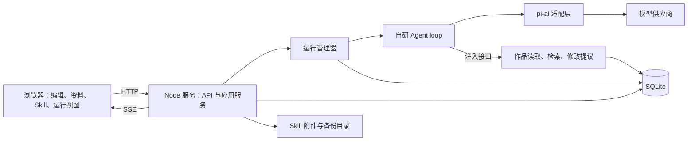
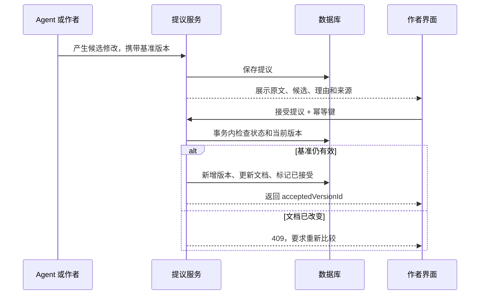
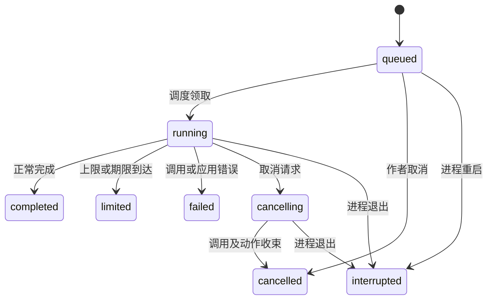

# AI 小说写作工作台技术设计文档

> 本文保留初版技术设计与发布规划，包含尚未交付的模型和接口。当前架构与契约见[实施基线](./实施基线与契约.md)，模块入口见[文档索引](./README.md)。文中的早期版本、限额和阶段状态按当时记录理解。

> 2026-11-04 更新：本文原先设计的轮次、工具次数、模型调用数、执行超时、Token 预算及循环长度限额已移除。工作流自动修订不再限制一次，改为可开关的持续修订。当前执行策略以 P04、P05 和 MA 实施说明为准；下文相关限额表格仅保留历史设计背景。

版本：v0.2 技术设计稿  
日期：2026-11-03  
关联：[产品需求](./PRD-AI小说写作工作台.md) · [技术决策](./技术方案与决策记录.md) · [需求确认表](./PRD-需求确认表.md) · [文档索引](./README.md)

**新增设计与实施入口（2026-11-04）：** [创作要素管理与 AI 逐项生成](./PRD-创作要素管理与AI生成.md)补充八类要素、专门面板、结构化字段及作品级批量候选。实际交付、schemaVersion=10 迁移、接口及验证限制见 [实施说明](./ELM-创作要素实施.md)。下文保留原阶段设计，涉及文档类型、确认版本和批量候选的扩展以新实施说明为准。

本文给出第一版的完整实现方案。2026-11-03 已执行 P00—P05：基础设施及小说工作区、不可变版本、小说导入/导出、Skill 管理，以及独立 Agent 循环和 pi-ai 适配已实现。P05 的实际资料、持久化运行、SSE、提议与写作聊天也已实现，详见 [P05 实施说明](./P05-写作流程实施.md)。真实供应商因配置缺失未验证。当前采用状态见 [实施基线与契约](./实施基线与契约.md)、[P02 实施与接口](./P02-小说工作区实施.md)、[P03 Skill 管理实施](./P03-Skill管理实施.md)及 [P04 Agent 循环实施](./P04-Agent循环实施.md)，运行说明见 [README](../README.md)。

## 1. 已确认决策与设计假设

### 1.1 已确认

- 前后端使用 TypeScript，通过 pnpm Workspace 组织项目。
- 使用 pi-ai 接入模型供应商；Agent loop 由项目自行实现。
- 第一版为单 Agent，支持 Skill 管理与实验、小说资料和编辑。
- Skill 兼容 SKILL.md 目录及附件，第一版仅作为提示词使用，不执行其脚本。
- 支持本机 Web 和服务器 Web；资料手动维护，AI 资料更新须由作者确认。

### 1.2 本文采用的建议默认方案

下列方案为设计默认值。P00/P01 已采用 React/Vite、Hono、SQLite/better-sqlite3、Zod、独立实例及有限动作循环等建议；P02 编辑器采用原生 textarea，数据访问使用显式 SQL 而非 Drizzle。采用状态不替代 PRD 中 D1—D6 的用户确认记录。

| 决策     | 本文默认方案                                                       | 若调整的主要影响                           |
| -------- | ------------------------------------------------------------------ | ------------------------------------------ |
| 前端     | React + Vite，Markdown 正文编辑                                    | 富文本会影响存储格式、选区和差异比较       |
| 后端     | Node.js 常驻进程 + Hono                                            | 更换框架应保持应用服务及 Agent 核心接口    |
| 数据     | SQLite + 本地文件目录                                              | 浏览器离线优先需要另行设计本地库与同步协议 |
| 数据访问 | better-sqlite3 + 显式 SQL 迁移（P01 实际采用）                     | 驱动原生依赖须在目标部署环境验证           |
| 输入校验 | Zod，契约统一定义后推导 TS 类型                                    | 不允许仅靠 TS 静态类型校验外部输入         |
| 编辑器   | P02 原生 textarea，正文按 Markdown 文本编辑；Skill 编辑归 P03      | 编辑器实例不作为持久化数据源               |
| 通信     | HTTP API + SSE 事件流                                              | 不在第一版加入协同编辑协议                 |
| 部署     | 每人独立实例；本机或服务器单进程运行                               | 共用服务需要增加账号和数据隔离模型         |
| 循环行为 | Agent 根据目录描述按需加载 Skill，调用有限应用能力至完成或达到限制 | 固定写作/审校流水线需要额外调度规则        |
| 修改应用 | 正文和资料都以提议形式由作者应用                                   | 自动写入模式需要单独确认                   |
| 恢复     | 手动重试；进程重启后标记中断，不自动续跑                           | 自动续跑需要完整任务接管和恢复协议         |
| 备份     | 实例备份/恢复，自动跨设备同步延后                                  | 自动同步需要冲突合并与凭据迁移设计         |

组件能力依据见第 20 节；P01 的精确依赖版本已写入 package.json 与锁文件，pi-ai 为 @earendil-works/pi-ai 1.5.0。不使用现成 Agent 运行框架替代自研循环核心。

## 2. 系统结构与部署模型



本机：服务监听 `127.0.0.1`，数据保存到本机配置的数据目录。服务器：同一构建产物运行在服务器，数据库与附件保存在服务器持久卷，浏览器通过 HTTPS 访问。服务器保存不等于浏览器本地保存。

生产构建由 Node 服务同时提供前端静态文件和 `/api/v1`，采用同源部署。开发时 Vite 将 API 请求代理至后端。Agent 在服务端后台执行，不依附某个 SSE 请求；关闭页面或网络断开不会取消任务。

单实例仅启动一个运行管理器，数据目录使用进程级独占锁，发现已有实例时拒绝启动。第一版不部署多个服务副本访问同一个 SQLite 文件，不把数据库放在网络共享文件系统上。SQLite WAL 的共享内存和并发限制参见[官方说明](https://www.sqlite.org/wal.html)。

## 3. Workspace 与依赖边界

```text
apps/
  web/src/
    features/          # projects、editor、materials、skills、runs、settings
    api/               # HTTP 客户端与 SSE 消费
    components/        # 通用交互组件
  server/src/
    http/              # 路由、鉴权、输入校验、错误响应、SSE
    services/          # 小说、版本、Skill、提议、导入导出
    runs/              # 运行管理器、调度、取消、记录
    tools/             # 应用能力实现
    db/                # schema、迁移、repository
    storage/           # 附件、凭据和备份
packages/
  agent/src/
    loop.ts            # 自研循环调度
    model/             # 自有接口及 pi-ai 适配
    tools/             # 动作注册、参数校验、执行协议
    context/           # 输入组装与预算估计
  shared/src/
    contracts/         # API、事件、错误及动作 schema
    domain/            # 数据对象、状态与枚举
docs/
pnpm-workspace.yaml
package.json
pnpm-lock.yaml
```

```yaml
# 建议的 pnpm-workspace.yaml
packages:
  - apps/*
  - packages/*
```

| 包     | 允许依赖                        | 不应依赖                            |
| ------ | ------------------------------- | ----------------------------------- |
| shared | 校验库和纯类型工具              | React、数据库、Node 文件系统、pi-ai |
| agent  | shared、pi-ai                   | HTTP 框架、数据库、前端             |
| server | shared、agent、数据库与服务端库 | web 源码                            |
| web    | shared、UI 与浏览器库           | agent、server、密钥模块             |

内部包通过 `workspace:*` 声明；在实际 `package.json` 的 `packageManager` 中固定 pnpm 版本。开启 TypeScript `strict`，统一 ESM，禁止将服务端依赖打包进浏览器。Workspace 的配置及内部依赖行为参见[pnpm 文档](https://pnpm.io/workspaces)。

已提供 `pnpm dev`、`pnpm build`、`pnpm typecheck`、`pnpm lint`、`pnpm test` 及 `pnpm test:smoke`；P02 增加 `pnpm test:e2e`，验证小说工作区的真实 Chromium 流程；P04 增加 `pnpm test:agent-smoke`，离线验证 Agent 两轮与注入动作。进程冒烟、业务 E2E 和 Agent 示例分别记录。

## 4. 核心对象与数据模型

### 4.1 通用约定

- ID 使用应用生成的 UUID；时间以 UTC 保存，前端按用户时区显示。
- 可编辑文档以 UTF-8 Markdown 文本为权威内容；正文、总纲、章纲、人物使用同一文档版本机制。
- 版本内容一经建立不修改，当前文档通过 `current_version_id` 指向最新版本。
- 模型、参数、提示词和实际资料引用在运行时记录；密钥不进入运行快照。
- 引用关系必须检查作品归属；数据库开启外键约束。涉及多个作品字段的引用使用复合约束或事务内一致性检查。

### 4.2 表结构设计

下表为逻辑模型；JSON 字段仅用于参数、事件及可扩展元数据，核心归属和状态保持独立列。

| 表                    | 关键字段                                                                                                                                                                                                      | 约束或用途                                                                      |
| --------------------- | ------------------------------------------------------------------------------------------------------------------------------------------------------------------------------------------------------------- | ------------------------------------------------------------------------------- |
| `projects`            | id、title、structure_version、created_at、updated_at                                                                                                                                                          | 作品；卷章结构修改使用独立版本号                                                |
| `volumes`             | id、project_id、title、sort_order                                                                                                                                                                             | 卷；章可不属于卷                                                                |
| `documents`           | id、project_id、volume_id、kind、chapter_id、title、sort_order、current_version_id、deleted_at                                                                                                                | kind 为 chapter/master_outline/chapter_outline/character；chapter_id 只用于章纲 |
| `document_versions`   | id、document_id、version_no、content、metadata_json、content_hash、source、created_at                                                                                                                         | 唯一 document_id + version_no；人物字段等与正文一起版本化                       |
| `skills`              | id、name、source_type、source_ref、source_commit、source_subdir、current_version_id                                                                                                                           | 本地导入或 Git 来源                                                             |
| `skill_versions`      | id、skill_id、version_no、entry_content、metadata_json、source_snapshot_json、manifest_hash                                                                                                                   | 不可变入口、来源快照与附件清单版本                                              |
| `skill_files`         | skill_version_id、relative_path、blob_hash、media_type、size_bytes                                                                                                                                            | 唯一版本 + 相对路径；文件内容按 hash 存储                                       |
| `test_cases`          | id、name、input_text、project_id、context_spec_json                                                                                                                                                           | 可复用案例；引用失效须提示                                                      |
| `sessions`            | id、project_id、chapter_id、title                                                                                                                                                                             | 聊天会话；章节为空表示作品级会话                                                |
| `messages`            | id、session_id、run_id、role、content_json、created_at                                                                                                                                                        | 展示层消息，不直接充当模型执行检查点                                            |
| `provider_configs`    | id、provider、base_url、default_model、options_json、credential_ref                                                                                                                                           | 仅非敏感配置与凭据引用                                                          |
| `runs`                | id、project_id、session_id、purpose、status、stop_reason、retry_of_run_id、config_json、input_json、context_hash、usage_json、last_event_seq、output_message_id、cancel_requested_at、created_at、finished_at | purpose 为 write/rewrite/review/skill_test；输入不含密钥                        |
| `run_documents`       | run_id、document_id、version_id、permission、selected、ordinal                                                                                                                                                | 创建时冻结可检索资料清单及版本；permission 区分只读和允许提议                   |
| `run_context_entries` | run_id、turn_index、source_type、source_id、version_id、excerpt、content_hash、citation_id                                                                                                                    | 记录每轮实际送入模型的内容及裁剪信息                                            |
| `run_turns`           | id、run_id、turn_index、status、request_json、partial_text、response_json、usage_json、error_json、checkpoint_json                                                                                            | 唯一 run_id + turn_index；完整一轮才建立检查点                                  |
| `tool_executions`     | id、run_id、turn_id、call_id、name、args_json、status、result_json                                                                                                                                            | 唯一 turn_id + call_id；动作结果可重查                                          |
| `proposals`           | id、run_id、turn_id、tool_execution_id、target_document_id、base_version_id、scope_json、proposed_content、status、accepted_version_id                                                                        | staged/pending/accepted/rejected/stale/abandoned；正文与资料共用                |
| `run_events`          | run_id、seq、type、payload_json、created_at                                                                                                                                                                   | 唯一 run_id + seq；服务端先落库后推送                                           |
| `idempotency_keys`    | scope、key、request_hash、response_json、created_at                                                                                                                                                           | 唯一 scope + key；覆盖创建任务及接受提议                                        |
| `auth_sessions`       | id、token_hash、expires_at、created_at                                                                                                                                                                        | 单实例访问会话，不是多用户账号；仅服务端模式启用                                |
| `schema_migrations`   | version、applied_at                                                                                                                                                                                           | 数据库迁移记录                                                                  |

`documents.current_version_id` 必须属于该文档；章纲所属章节、卷与文档必须属于同一作品。删除采用软删除，已被运行引用的历史内容不级联删除。首版不提供不可恢复清理历史的入口。

P05 实际落库以 `0004-writing.sql`、`0005-writing-citations.sql` 为准，后续 `0006-agent-prompt.sql` 增加全局 Agent 提示词设置，当前 schemaVersion=6。上表为逻辑模型：非敏感模型配置与完整初始输入合并在 runs.snapshot_json，候选为 output_json，轮次以 run_id/turn_index 联合主键标识；实际引用以 entry_json 保存片段、元数据和范围。provider_configs 使用 config_json/revision，messages 使用 content 文本；agent_prompt_settings 保存提示词及修订号。test_cases 归 P06、auth_sessions 归 P07，尚未创建；字段映射和 API 见 [P05 实施说明](./P05-写作流程实施.md)。

建议索引：`documents(project_id, kind, sort_order)`、`document_versions(document_id, version_no)`、`runs(project_id, created_at)`、`runs(status, created_at)`、`proposals(target_document_id, status)`、`run_events(run_id, seq)`。对活跃写作任务增加条件唯一约束，覆盖 purpose 为 write/rewrite 且 status 为 queued/running/cancelling 的记录，避免同一作品的任务并发。write/rewrite 必须有 project_id；无作品资料的 Skill 实验允许 project_id 和 session_id 为空。

### 4.3 文件存储

```text
DATA_DIR/
  workbench.sqlite
  blobs/<hash前两位>/<完整sha256>    # 不可变 Skill 附件
  tmp/                             # 导入、Git 获取和恢复暂存
  backups/                         # 完整备份包
  credentials.enc                  # 独立凭据存储，不进备份
```

正文、Skill 入口和版本元数据存库；附件使用内容 hash 寻址。先将附件写入临时文件并原子移动到 blobs，再事务提交引用；失败可以遗留无引用文件，不得产生引用不存在文件的已提交版本。首版不自动回收 blobs，降低备份期间附件被删除的复杂度。

## 5. 文档保存、版本与修改提议

### 5.1 自动保存

客户端每份文档最多一个保存请求在途；编辑后建议等待 800ms 再保存。请求携带 `baseVersionId`，服务端在短事务中比较当前版本，新增历史版本并更新指针。成功返回新版本 ID；客户端将保存期间产生的新编辑接着提交。

版本不匹配返回 `409 VERSION_CONFLICT`，携带最新版本 ID。前端保留本地未保存文本，提供差异查看或手动合并，不用旧请求覆盖远端新稿。章节切换不销毁待保存队列；失败时展示未保存状态并允许重试。

历史恢复也新增版本，其内容来自被选中的旧版本；不回退或删除历史记录。卷章移动、排序通过 `structure_version` 做同类并发检查。

### 5.2 提议应用



接受操作和创建文档版本必须在同一事务内完成；重复提交同一提议返回原应用结果。幂等键相同但请求内容不同，返回冲突。选中改写的 `scope_json` 包含基准版本、UTF-16 起止偏移及原文校验值；服务端验证范围与原文，避免修改错段。

运行内生成的提议先为 `staged`，该轮所有响应和动作完成落库时转为 `pending`，再允许作者接受。失败轮次的 staged 提议标为 `abandoned`，不可接受。这样失败重试不产生可被误用的半轮修改。

本文默认提议审核独立于 loop：Agent 保存提议后可以结束，作者稍后应用，不持有数据库事务或等待中的模型连接。需要“确认后继续”的流程时，另行引入持久化等待节点。

## 6. Skill 导入、解析与实验

### 6.1 导入与预览

1. 本地文件或目录通过浏览器上传；服务器不会把用户电脑路径当作可访问路径。单个 SKILL.md 可导入，缺失附件单独提示。
2. Git 导入默认仅支持公开 HTTPS 仓库，记录仓库、子目录和最终提交；在隔离临时目录获取后再复制需要的文件。
3. 解析 SKILL.md 可选 front matter 和 Markdown 正文。保存未知元数据；首版只要求入口存在且可按 UTF-8 读取，不承诺所有 Agent 平台的 Skill 执行语义。
4. 标准化相对路径，拒绝目录越界、符号链接越界与重复路径；限制文件数、单文件及总大小，Git 获取有超时和体积上限。
5. 生成不可变 Skill 版本及附件 manifest；把当时的仓库、子目录和 source commit 一起存进版本的来源快照，不只保存在 Skill 当前记录上；不自动修改导入源或推送远端。
6. Markdown 预览禁用不可信原始 HTML，附件只按允许类型预览；脚本不执行。示例从明确的示例章节或文件展示，无示例则为空。

公开仓库限制、导入大小阈值及支持预览的附件类型是建议实现边界。P03 采用 isomorphic-git 与自定义 HTTPS 传输，不调用 shell 或系统 Git；不递归子模块、不启用凭据助手，校验并固定公网 DNS 地址，拒绝重定向并限制下载体积/耗时。具体阈值与支持范围以 P03 实施说明为准。

编辑时以应用内工作副本为准。保存生成新版本；关联附件可以查看，编辑范围建议先限文本文件。Git 更新需要显式操作并生成新版本，运行中的版本保持不变。

### 6.2 试运行与比较

Skill 试运行复用同一运行引擎，`purpose=skill_test`。默认只有输入文本及作者选定资料，无正文写入动作。案例保存输入模板与引用；每次运行另存解析后的实际输入快照。

比较两个 Skill 版本时创建两次独立运行，固定案例快照、供应商、模型和参数；共享 `comparisonId` 写入运行配置。并排展示结果及文本差异；某侧失败单独标记，不能把缺失内容当作空文本进行质量比较。不增加跨模型评测或 AI 自动评分。

## 7. 上下文与检索

### 7.1 资料范围冻结

创建运行时，服务端固定可用 Skill 目录（名称、description、不可变版本标识）、输入文本、目标文档基准版本和资料范围。系统提示词只注入 Skill 目录，由 Agent 调用 load_skill 按需加载全文、read_skill_file 读取关联文本，可使用多个 Skill。写作界面不要求选择 Skill；可选 skillVersionId 用于明确指定版本或实验。`run_documents` 保存允许检索的文档版本清单；清单是权限边界，选中的资料是首次直接输入的子集。

同一事务内固定非敏感供应商配置、modelId、模型参数及 credentialRef 到 `runs.config_json`。后续改设置不改变已有运行的 base URL、模型和参数；凭据在调用时通过固定引用解析，密钥轮换仍可生效，实际密钥不进入快照。

自动检索只能读取该清单中的不可变版本。运行期间新增的人物或修改后的章节不会悄悄进入本次运行。若作者希望使用新资料，需要重新发起任务。

### 7.2 推荐与输入预算

第一版建议使用章纲关系、人物姓名/别名匹配、相邻前文和关键词片段匹配。先实现可解释的中文文本检索；不把 SQLite 默认全文分词直接视为已经解决中文语义检索。检索依据冻结版本内容，输出稳定引用 ID，如 `doc:<id>@<version>#<片段号>`。

组装顺序为：应用规则与 Skill 使用规则 → 可用 Skill 目录摘要 → 任务与目标范围 → 作者固定资料 → 推荐资料 → 已完成的消息与动作结果。Skill 全文和附件只在调用后作为工具结果进入后续上下文。区分已发生的前文与后续章纲；后续规划只有作者允许才进入范围。

上下文预算同时计入工具定义、消息、资料和预留输出。没有可靠 tokenizer 时标注估算，并保留余量；超限先裁剪低优先级推荐片段，作者固定资料仍超限则停止并要求调整。所有裁剪记录到运行输入，不静默丢弃固定资料。

模型反馈上下文超限时返回 `CONTEXT_TOO_LARGE`，不盲目重试同一输入。引用只能指向本次实际读取或输入过的资料；界面将模型声称的引用与记录校验，无效引用标记为未验证。

## 8. 模型适配与自研 Agent loop

### 8.1 pi-ai 边界

所有 SDK 导入集中在 `packages/agent/src/model`。适配层把供应商响应转为应用自己的文本事件、动作请求、结束原因、用量和错误；其余模块不直接处理供应商特定事件。

pi-ai 的公开文档提供流式模型调用与工具调用示例；动作的实际执行仍由应用完成。P04 再核验稳定包名/版本为 `@earendil-works/pi-ai@1.5.0`，按安装包实际导出实现 Completions、Responses、Anthropic 三种文本/工具协议，使用真实 SDK 解析模拟 HTTP/SSE 测试。凭据解析注入、SDK 自动重试关闭，未进行真实供应商连通验证。[上游 README](https://raw.githubusercontent.com/badlogic/pi-mono/main/packages/ai/README.md)

以下是应用自定义契约摘要，不是 pi-ai 的真实接口签名；完整运行时契约以 shared/agent.ts 为准，接入说明见 [P04 实施文档](./P04-Agent循环实施.md)：

```typescript
type Json = null | boolean | number | string | Json[] | { [key: string]: Json };

interface ToolCall {
  id: string;
  name: string;
  arguments: Json; // 按已注册动作的 schema 校验后使用
}

interface Usage {
  inputTokens: number | null;
  outputTokens: number | null;
  cost: { amount: string; currency: string; source: 'provider' | 'estimate' } | null;
}

interface ModelResponse {
  transcriptMessage: AssistantTranscript;
  text: string;
  calls: ToolCall[];
  stop: 'complete' | 'tool_calls' | 'truncated' | 'error' | 'aborted';
  usage: Usage;
  errorCode?: string;
}

type ModelEvent =
  | { type: 'text_delta'; text: string }
  | { type: 'tool_call_delta'; callIndex: number; delta: string }
  | { type: 'response'; response: ModelResponse };

interface AssistantTranscript {
  role: 'assistant';
  content: string;
  toolCalls: ToolCall[];
  protocol?: { adapter: string; message: Json }; // 完整 SDK 协议含签名，剔除诊断/原始错误
}

type TranscriptMessage =
  | { role: 'user'; content: string; timestamp: number }
  | AssistantTranscript
  | {
      role: 'toolResult';
      toolCallId: string;
      toolName: string;
      result:
        | { callId: string; ok: true; value: Json }
        | { callId: string; ok: false; error: { code: string; message: string } };
      timestamp: number;
    };

interface ModelRequest {
  connectionSnapshot: Json; // 已冻结的非敏感连接配置和 credentialRef
  modelId: string;
  systemPrompt: string;
  messages: TranscriptMessage[];
  toolDefinitions: Json[];
  parameters: Record<string, Json>;
}

interface ModelAdapter {
  readonly id: string;
  validateRequest?(request: ModelRequest): void; // 在任何记录前验证适配器特有的非敏感配置
  stream(request: ModelRequest, signal: AbortSignal): AsyncIterable<ModelEvent>;
}
```

每个成功开始的调用应产生一个最终 `response`；网络中断等异常也可能抛错，loop 必须处理“有文本分片但无完整响应”。必须保留工具 call ID、完整 assistant 消息及对应结果的协议结构，不能只保存可见文本后尝试续聊。

`Usage` 的空值表示未知；缓存等更多用量字段保留在供应商原始用量记录中。SDK 将缺失 Token 补零而没有字段存在标记，P04 的 pi-ai 适配对零计数保守记 null；明确提供零的自定义适配器仍可记零。金额用十进制字符串保存，避免展示结算时累积浮点误差；不同币种不直接合计。价格未知则费用未知，显式冻结价格的估算标 estimate，供应商明确返回的账单标 provider。

### 8.2 应用能力注册表

下列能力已在 P00/P01 作为应用协议采用，参数和结果由 shared schema 定义。P04 已实现固定注册、顺序调度及运行时校验，具体检索/提议与资料权限已由 P05 注入，Skill 测试用途保持只读。它们由程序注册，Skill 不能增加可执行能力。

| 动作                      | 参数要点                                                     | 行为与约束                                                      |
| ------------------------- | ------------------------------------------------------------ | --------------------------------------------------------------- |
| `load_skill`              | versionId                                                    | 加载本次 Skill 目录内版本的完整 SKILL.md、附件路径与诊断        |
| `read_skill_file`         | versionId、path、range                                       | 只读该版本 manifest 中的 UTF-8 文本，最多 8000 字符，可继续读取 |
| `search_documents`        | query、kinds、limit                                          | 检索本次冻结清单，返回限长片段及引用                            |
| `read_document`           | documentId、versionId、range                                 | 读取允许的版本及范围；不接受任意路径                            |
| `propose_document_change` | content、reason、citations | 服务端绑定本次授权目标、版本和范围，返回 proposalId、targetDocumentId、status=staged |

运行创建时从用途决定能力白名单：write/rewrite 可对指定章节提议；review 可按作者授权对资料提议；skill_test 默认不开放提议动作。任何工具参数里的 projectId 都不能改变运行的作品归属。`read_document` 不得绕过 `run_documents`；提议不得绕过目标范围和基准版本。

第一版动作顺序执行；即使模型一次返回多个动作，也按响应顺序处理，并配置单轮动作数上限。超过上限时整批不执行，记录限制原因并结束为 limited。参数无效、未知动作、目标不可访问时返回带对应 call ID 的结构化错误，让模型在剩余轮次内修正。动作执行结果必须限长，后续大段读取通过新的范围请求完成。

### 8.3 循环算法

一轮定义为一次模型调用及其返回动作的处理，不把每个工具调用单独计算为模型轮次。以下为伪代码：

```text
加载运行输入、冻结的 Skill 目录、资料清单与最近完整检查点
领取 queued 任务并提交 running 状态
while 已用轮次 < maxTurns:
    检查取消信号、任务期限和已知用量限制
    组装本轮输入，保存请求记录，发出 turn.started
    调用模型；合并文本分片、持久化后发出 text.delta
    取得完整响应并保存用量
    若取消、错误或输出截断：结束为对应状态，不执行动作
    校验结束原因与动作列表是否一致
    若含动作：
        保存完整 assistant 消息
        顺序校验并执行动作，保存对应结果
        事务提交本轮检查点、激活提议和 turn.completed 事件
        继续下一轮
    若正常完成且无动作：
        保存候选输出、完整检查点和完成事件
        结束为 completed
超过轮次上限：结束为 limited/max_turns
```

返回动作但结束原因不完整、同一响应中 call ID 重复或协议结构无法映射时，按 `MODEL_PROTOCOL_ERROR` 处理，不执行猜测出来的动作。普通回答可能只是检查结论，只有 write/rewrite 用途的最终输出才呈现“应用为正文候选”入口；聊天文本不自动变成正文。

模型尚在流式产生参数时不执行动作。循环开始、动作开始前均检查取消；已进入数据库事务的本地动作允许原子结束，随后取消。每一轮的状态、完整消息与检查点在短事务内提交，模型调用期间不持有写事务。

达到 maxTurns 时，即使最后一轮已经完成读取或产生提议，也不再补发一轮“总结”调用。已有结果保留，但状态为 limited，不能显示为成功完成。

P04 核心通过 `LoopRecorder.record/commitTurn/finish` 注入记录与事务；commitTurn 原子提交检查点、激活提议及完成事件，finish 提交终态，P05 已实现 SQLite 原子持久化，SSE 只发送已提交事件。检查点包含完整规范消息及原始 SDK assistant 协议，只在整轮完成后推进；手动重试的新 run 复用已完成工具结果，本次轮数/期限与用量单独累计。MemoryLoopRecorder 仅供离线测试。具体结构、失败不确定性与处理器取消责任见 P04 实施说明。

### 8.4 输出转提议

模型通过动作生成提议，或者作者在最终结果上点击“应用”，均进入同一个提议服务。后者由服务端依据运行创建时的目标和基准版本，将选定候选内容转成提议，不接受客户端指定任意目标文档。文本检查失败或基准失效时要求重新比较。

Skill 试运行结果仅供实验展示。作者可手动复制文本，但该用途不通过 API 对正式文档创建提议。

## 9. 运行生命周期、取消与重试

### 9.1 状态机



completed/limited/failed/cancelled/interrupted 为终态，终态不改回 running。结束状态与对应 `run.finished` 事件在同一事务内写入。取消和正常完成竞争时，以服务端事务状态检查为准：取消请求若先被接受，结果不再提交为 completed；任务已完成则取消接口返回当前终态。

作者确认提议是独立生命周期，不把 run 一直留在 `waiting_confirmation`。暂停和跨重启自动续跑不在本文默认方案内。

### 9.2 调度与资源

运行管理器从数据库领取 queued 任务，内存中保存运行对应的 AbortController。建议初始全局并发为 1，同一作品仅允许一个活跃 write/rewrite 任务；创建第二个此类任务返回 `409 PROJECT_BUSY`，而不是悄悄排到另一项写作之后。Skill 实验可排队并复用全局槽位。

建议默认 maxTurns=8、单模型调用超时=120 秒、单任务期限=10 分钟，均为可配置的评审起点。全局期限从 running 开始计算，不含排队时间。取消、单调用超时和任务期限使用关联的取消信号，但对外保留不同 stop_reason。

金额预算若启用，只能在费用可估算时检查；无法估算的模型应拒绝开启“硬金额预算”或明确降为提示模式。已经提交给供应商的请求可能继续计费，不能承诺精确金额封顶。

### 9.3 重启与重试

持有数据目录独占锁后，启动恢复逻辑将上次遗留的 queued/running/cancelling 标为 interrupted，未完成轮次的 staged 提议标为 abandoned，保留记录，等待作者决定。优雅关闭先停止领取任务，再取消活跃模型调用，完成可提交的短事务，最后关闭数据库；关闭等待设有限期限，未能正常收束的任务由下次启动恢复。

重试通过创建新 run 实现，原 run 保持终态。新 run 记录 `retry_of_run_id`，沿用原输入快照和最近完整轮次检查点；已完成动作的结果直接复用，不重新执行。失败轮次的 staged 提议作废，重试从该轮之前开始，因此可能重新产生模型费用。

如果检查点最后是工具结果，必须保留与之匹配的 assistant 工具调用消息。没有可验证完整检查点则从初始输入重跑。重试沿用旧资料版本；需要最新资料时使用“新任务”而非重试。

默认不自动重试状态不明的远端请求，不声称模型调用具有 exactly-once 语义。允许自动重试的范围和次数以后单独决定。

## 10. HTTP API 契约

### 10.1 通用约定

前缀 `/api/v1`，JSON 请求体按共享 schema 校验；列表采用稳定游标分页，建议默认 50、上限 200。单资源返回 `{ "data": ... }`，列表附加 `nextCursor`。错误结构：

```json
{
  "error": {
    "code": "VERSION_CONFLICT",
    "message": "文档已更新，请比较后重新应用",
    "requestId": "req-example",
    "details": { "currentVersionId": "version-example" }
  }
}
```

运行创建返回 `202` 和 run ID。创建运行、创建重试和接受提议要求 `Idempotency-Key`；幂等范围按当前实例、操作及目标资源区分，校验请求 hash，建议记录至少保留至相关运行/提议被清理。首次请求的资源写入和幂等结果一起提交。

### 10.2 端点清单

| 方法与路径                                                                                                               | 用途                       | 关键约束                             |
| ------------------------------------------------------------------------------------------------------------------------ | -------------------------- | ------------------------------------ |
| `GET /health`、`GET /ready`                                                                                              | 进程存活、数据库及迁移可用 | 不暴露凭据和作品内容                 |
| `POST /auth/session`、`DELETE /auth/session`                                                                             | 建立、注销实例访问会话     | 服务器模式使用；不返回已保存凭据     |
| `GET /projects`、`POST /projects`                                                                                        | 项目列表、创建             | 标题长度校验                         |
| `GET /projects/:id`、`PATCH /projects/:id`                                                                               | 项目详情、改名             | 校验实例访问权限                     |
| `GET /projects/:id/structure`、`PUT /projects/:id/structure`                                                             | 卷章结构读取与调整         | baseStructureVersion；事务更新       |
| `POST /projects/:id/documents`                                                                                           | 新建章节、大纲或人物       | kind 和关联归属检查                  |
| `GET /documents/:id`、`PUT /documents/:id`                                                                               | 读取、保存文档             | 保存携带 baseVersionId               |
| `DELETE /documents/:id`                                                                                                  | 软删除                     | 检查基准版本及活跃运行依赖           |
| `GET /documents/:id/versions`、`GET /documents/:id/versions/:versionId`                                                  | 历史列表与内容             | 版本必须属于该文档                   |
| `POST /documents/:id/restore`                                                                                            | 恢复历史为新版本           | baseVersionId + restoreVersionId     |
| `POST /projects/:id/imports`、`GET /projects/:id/imports/:importId`、`POST /projects/:id/imports/:importId/confirm`      | 上传、预览拆章、确认       | 预览阶段不写正式作品                 |
| `GET /projects/:id/export.txt`                                                                                           | 导出 TXT                   | 可选章节；顺序来自当前卷章结构       |
| `GET /skills`、`GET /skills/:id`                                                                                         | Skill 列表与详情           | 返回来源、当前版本和文件清单         |
| `POST /skills/imports`、`GET /skills/imports/:importId`                                                                  | 本地/Git 导入及状态        | 异步获取，限制来源及资源             |
| `GET /skills/:id/versions`、`POST /skills/:id/versions`                                                                  | 版本列表、保存编辑         | 提交 baseVersionId 和附件 manifest   |
| `POST /skills/:id/refresh`                                                                                               | 显式重新获取 Git 来源      | 新建版本，不替换历史                 |
| `GET /skills/:id/files`                                                                                                  | 预览指定版本附件           | relativePath 与版本清单匹配          |
| `GET /test-cases`、`POST /test-cases`、`PUT /test-cases/:id`                                                             | 实验案例管理               | 不保存在案例中的凭据                 |
| `GET /projects/:id/sessions`、`POST /projects/:id/sessions`                                                              | 会话管理                   | 章节必须属于作品                     |
| `GET /sessions/:id/messages`                                                                                             | 聊天记录                   | 按稳定顺序分页                       |
| `POST /context/preview`                                                                                                  | 推荐资料、预览预算         | 不产生运行；返回版本引用供创建时复核 |
| `GET /runs`、`POST /runs`、`GET /runs/:id`                                                                               | 列表、创建、快照与进度     | 创建固定 Skill、输入及资料版本       |
| `GET /runs/:id/events`                                                                                                   | SSE 订阅与重放             | 见第 11 节                           |
| `POST /runs/:id/cancel`、`POST /runs/:id/retry`                                                                          | 取消、显式重试             | retry 仅允许非成功终态               |
| `POST /runs/:id/output-proposals`                                                                                        | 最终候选文本转提议         | 目标由服务端从运行快照确定           |
| `GET /proposals`、`POST /proposals/:id/accept`、`POST /proposals/:id/reject`                                             | 审阅与处理提议             | 接受检查基准版本和幂等性             |
| `GET /providers`、`PUT /providers/:id`、`POST /providers/:id/test`                                                       | 配置和测试供应商           | 密钥仅写不读，测试可能产生费用       |
| `POST /backups`、`GET /backups/:id`、`GET /backups/:id/download`、`POST /restores/preview`、`POST /restores/:id/confirm` | 备份与恢复                 | 恢复排空运行且要求独占维护窗口       |

导入暂存和备份任务使用自己的持久化 manifest 与状态文件，包含任务 ID、状态、错误及过期时间，不占用 Agent 的 runs 表；重启时未完成任务标为中断。若后续需要复杂任务队列，再引入统一 jobs 表。

### 10.3 创建运行示例

```json
{
  "projectId": "project-example",
  "sessionId": "session-example",
  "purpose": "rewrite",
  "input": "保留人物语气，重写当前选中段落",
  "target": {
    "documentId": "chapter-example",
    "baseVersionId": "version-example",
    "selection": { "from": 120, "to": 260, "textHash": "sha256-example" }
  },
  "skillVersionId": "skill-version-example",
  "providerConfigId": "provider-example",
  "modelId": "configured-model-id",
  "context": {
    "selectedVersionIds": ["character-version-example"],
    "allowSearch": true,
    "allowFutureOutline": false
  },
  "limits": { "maxTurns": 8 }
}
```

创建时校验所选版本和预览时一致；有变更返回冲突，请作者确认后重建输入。模型和供应商是否支持所需工具调用也在创建时检查。公开契约不接收任意系统权限、可执行脚本、工具实现或密钥。

## 11. SSE 事件、重连与前端状态

### 11.1 事件协议

每条事件使用 run 内递增 seq。SSE 的 `id` 为该 seq，`event` 为固定事件类型，`data` 为带 `schemaVersion` 的 JSON。协议示例：

```text
id: 17
event: text.delta
data: {"schemaVersion":1,"runId":"run-example","seq":17,"turnIndex":2,"messageId":"message-example","text":"他停在门前。"}

```

| 事件                   | 主要字段                                   | 语义                             |
| ---------------------- | ------------------------------------------ | -------------------------------- |
| `run.started`          | modelId、startedAt                         | 已领取并开始执行                 |
| `turn.started`         | turnIndex                                  | 开始一个模型轮次                 |
| `text.delta`           | turnIndex、messageId、text                 | 本轮公开文本增量，不表示正式正文 |
| `tool.arguments.delta` | turnIndex、callIndex、delta                | 参数分片展示，不触发动作执行     |
| `tool.started`         | executionId、callId、name                  | 动作经过完整响应解析，准备执行   |
| `tool.completed`       | executionId、resultSummary、isError        | 动作执行或校验结果               |
| `proposal.created`     | proposalId、targetDocumentId               | 提议已变为 pending，可审阅       |
| `turn.completed`       | turnIndex、usage                           | 完整检查点已保存                 |
| `run.finished`         | status、stopReason、usage、outputMessageId | 唯一终态通知                     |

类型通过共享 schema 定义为可辨识联合，前端对未知事件类型记录并跳过，对不兼容 schemaVersion 提示刷新。错误详情保存在运行快照，终态事件仅携带允许对外的摘要。

### 11.2 可靠投递

所有对外事件先写 `run_events` 再发送。每次追加事件在事务中递增 `runs.last_event_seq`。文本增量建议按 50ms 或 4KiB 合批，和 `run_turns.partial_text` 一起提交，不按每个 Token 单独开启事务；终态前提交剩余文本。进程异常时尚未提交的小段文本可能丢失，前端从持久化记录重建后显示“已中断”。

SSE 处理器始终按 seq 从数据库读取大于游标的事件，进程内通知只负责唤醒查询；无通知时短轮询兜底，因此不存在“重放后再订阅”导致漏事件的窗口。设置有界发送批次，不让慢客户端阻塞 Agent；积压过大时断开，让客户端按游标重连。

自动重连优先使用有效的 `Last-Event-ID`；仅在没有该请求头时使用 `after=<seq>` 作为初始游标。EventSource 自动重连会保留最初 URL，因此 after 可能落后于请求头，不能因两者不同而拒绝正常重连。游标格式非法时明确拒绝，不静默回退。前端按 seq 去重，再拼接文本，不能把重复事件再次追加。

`GET /runs/:id` 返回同一数据库快照中的状态和 `lastEventSeq`；页面首次加载可先取快照，再从该 seq 之后订阅。旧游标早于保留窗口时返回 `410 EVENT_CURSOR_EXPIRED`，客户端重新读取快照。终态事件读完后客户端主动关闭 EventSource，服务端不再保持连接。

心跳使用 SSE 注释，不占 seq；建议 15 秒一次。Hono 提供 SSE 流式能力，但游标、持久化和重放由应用实现。[Hono 流式文档](https://hono.dev/docs/helpers/streaming)、[SSE 格式与重连说明](https://developer.mozilla.org/en-US/docs/Web/API/Server-sent_events/Using_server-sent_events)

### 11.3 前端职责

编辑器本地草稿、服务器文档版本和 Agent 候选结果分别存放；流式输出不直接修改正文编辑器。以运行 ID 管理订阅，同一页面共享连接；切换章节可继续显示后台任务，避免每个面板分别占一条 SSE。

提交任务前等待目标文档保存成功；网络或保存失败时不启动基于旧版本的任务。应用提议后更新版本与编辑器；若本地有未保存内容，先要求处理本地草稿再接受，服务端版本检查仍必须保留。

## 12. 错误分类与可观测性

### 12.1 错误映射

| 错误码                                                           | HTTP 或运行表现                   | 是否建议原样重试                   |
| ---------------------------------------------------------------- | --------------------------------- | ---------------------------------- |
| `VALIDATION_ERROR`                                               | 400，字段级错误                   | 修改输入后重试                     |
| `UNAUTHENTICATED` / `FORBIDDEN`                                  | 401 / 403                         | 重新登录或调整权限                 |
| `NOT_FOUND`                                                      | 404，不泄露其他资源详情           | 检查引用                           |
| `VERSION_CONFLICT` / `IDEMPOTENCY_CONFLICT`                      | 409                               | 比较或更正请求后重试               |
| `PROJECT_BUSY` / `MAINTENANCE_MODE`                              | 409 / 503                         | 等任务结束或维护完成               |
| `CONTEXT_TOO_LARGE`                                              | 创建前可返回 422；执行中则 failed | 减少上下文后发新任务               |
| `PROVIDER_AUTH_ERROR`                                            | failed                            | 修正供应商配置                     |
| `PROVIDER_RATE_LIMIT` / `PROVIDER_UNAVAILABLE`                   | failed，记录可用的 retryAfter     | 作者决定是否稍后重试               |
| `MODEL_TIMEOUT` / `MODEL_PROTOCOL_ERROR`                         | failed                            | 显式重试，说明可能新增费用         |
| `OUTPUT_TRUNCATED`                                               | limited                           | 保留部分结果，调整输出限制后再运行 |
| `MAX_TURNS` / `MAX_TOOL_CALLS` / `RUN_DEADLINE` / `BUDGET_LIMIT` | limited                           | 调整限制后重试或发新任务           |
| `STORAGE_ERROR`                                                  | 503 或 failed；禁止报告保存成功   | 恢复存储后重试                     |

应用动作的参数/权限错误作为工具结果交给模型，不必立即终止整次运行；底层存储不可用则应终止，不能假装提议已保存。供应商拒绝、内容过滤等结束原因独立记录，不归为正常成功。

### 12.2 日志与运行记录

结构化日志包括 requestId、runId、turnId、toolExecutionId、事件类型、耗时和允许公开的错误码。普通日志不包含密钥、完整提示词、正文和供应商原始请求头。

任务详情按作者需求保留实际提示词与资料输入，这些写入应用数据库，不混进运维日志。技术错误堆栈仅在服务端记录，API 返回可理解的摘要。

运行管理器记录排队时间、首段文本耗时、单轮耗时、总耗时及可用用量。缺失 Token、费用和缓存统计保持未知；运行聚合包含已知值及统计是否完整，不把部分统计呈现为精确总账。

终态后的增量事件建议在 7 天后清理，完整响应、检查点、版本及提议继续保留；该保留期为建议配置。清理前运行快照必须足以重建页面，并更新最早可用事件游标。活跃运行不清理事件。

## 13. 持久化、导入导出与迁移

### 13.1 SQLite 访问

建议启用 foreign_keys、WAL 和有限 busy_timeout；数据库仅由服务进程访问。同步驱动的事务保持短小，不在事务内等待网络、Git 或模型。批量导入分阶段预处理，确认后再批量提交；不得在请求线程执行长时间压缩或全量 CPU 密集检索。

版本写入、提议接受和终态提交通过数据库事务保证本地原子性，不能由多次独立 repository 写入拼出“看起来成功”的中间状态。[SQLite 事务说明](https://www.sqlite.org/lang_transaction.html)

### 13.2 小说导入与导出

导入先生成暂存预览：选择编码、识别标题和章节边界、显示拆分结果，作者可修正后确认。默认 UTF-8，无法解码时提示选择支持的编码，不以乱码内容自动入库。标题规则只是辅助，不能依赖一个正则覆盖所有小说。

确认导入事务检查项目结构版本，建立章节与初始内容版本；同一导入 ID 重复确认返回原结果。空章、重复标题和无法识别的段落在预览中显示，不自动丢弃。TXT 导出按当前卷章排序，统一换行，输出标题及正文；不导出聊天、密钥和运行记录。

### 13.3 迁移

schema 变更通过版本化迁移文件管理。启动先检查迁移状态；迁移失败时 readiness 失败，拒绝继续接受写入。升级前生成可恢复备份，迁移在独占维护窗口执行。

不承诺数据库降级；回退应用前需检查 schema 是否兼容，否则恢复对应备份。Node 版本、pnpm 版本、数据库 schema 版本和备份格式版本分别记录，不能混用一个应用版本代替兼容检查。

## 14. 备份与恢复

本文默认提供完整实例备份；TXT 导出负责作品文本交付。选择性项目备份和自动同步留待后续，避免把“复制整个库”误称为“导出单个项目”。

### 14.1 备份过程

1. 检查没有活跃运行、导入确认或其他写入操作；有则返回忙，作者决定何时重试。
2. 获取应用写入维护门闩，暂停领取任务并等待已进入的短事务结束；所有变更入口共用此门闩。
3. 使用 SQLite 一致性备份机制生成数据库快照，读取快照中所有附件 hash，并记录 manifest。
4. 快照建立后释放写入门闩。附件不可变且首版不回收，因此可以在后台复制清单中的文件并打包。
5. 校验数据库、文件 hash、schemaVersion、backupFormatVersion 和总清单，原子发布备份包。

不直接复制运行中的 `.sqlite` 文件后忽略 WAL；一致性快照应使用所选驱动支持的 SQLite Backup API 或经验证的等效机制。[SQLite 备份文档](https://www.sqlite.org/backup.html)

备份排除凭据文件、主密钥、会话表内容、临时导入目录。备份中保留非敏感供应商配置，但恢复后要求重新配置密钥；删除快照中的 auth_sessions 后再进行校验和打包。

### 14.2 恢复过程

先上传到临时目录，校验包路径、大小、hash、数据库完整性与版本兼容性，返回内容预览。确认恢复时进入维护窗口，排空活动任务和变更请求，关闭 SSE、停止运行管理器，保留当前实例的回退副本。

关闭数据库连接后替换数据库和附件目录，运行必要迁移与完整性检查；检查成功再开放服务。替换中途失败按恢复日志回退，不允许混用新库与旧附件。恢复后所有旧登录会话失效、非终态任务转 interrupted，并重新配置供应商凭据。

该操作覆盖当前实例数据；界面必须明确显示覆盖范围并提供确认。这里定义产品行为，不在本次文档任务中执行实际恢复。

## 15. 访问控制与凭据

### 15.1 单实例访问

本机模式只绑定 loopback，校验 Host 与 Origin，拒绝跨站写请求；不能因为“仅本地”就开放任意 CORS。服务器模式启用 HTTPS 和实例访问认证，未配置访问凭据时拒绝以服务器模式对外运行。

建议通过环境注入随机生成的高强度实例访问令牌。登录接口验证后签发随机 opaque 会话令牌，仅保存 hash 和过期时间，浏览器通过 HttpOnly、Secure、SameSite Cookie 使用；不把实例令牌放进 URL。所有变更请求检查 Origin，鉴权会话覆盖 API、附件、下载及 SSE。健康检查可公开，但不返回内部信息。

该认证只控制整个实例的访问，不提供用户间隔离。共享一套实例的人会访问同一工作区；若朋友需要各自私有作品，应独立部署，或先实现账号和资源归属再共用。服务端从当前实例及会话上下文确定权限，不信任客户端传入的 owner 字段。

### 15.2 模型凭据

供应商密钥优先从部署环境读取。若允许设置页面持久保存密钥，使用独立加密凭据存储：主密钥通过服务器 secret 注入，本机模式可在备份目录之外的配置位置生成并限制文件权限。

建议使用 Node crypto 支持的 AES-256-GCM：每次写入生成新的随机 nonce，保存格式版本、keyId、nonce、认证标签和密文；主密钥不与密文一起打包。缺少或无法解密时报告凭据不可用，不覆盖原值。[Node crypto 文档](https://nodejs.org/api/crypto.html)

密钥输入只写不回显，读取配置只返回“已配置”和脱敏标识。实际凭据在请求时解析，不存入 run、Skill、测试案例、前端 bundle 或诊断日志；服务器自定义 base URL 需要受控配置，不能由模型动作修改。

### 15.3 Skill 与模型输入边界

资料和 Skill 中的文字无法提升应用权限；作品归属、可读版本和可提议范围均由服务端检查。模型不能通过提示词获得任意文件读取、shell、网络访问或凭据读取能力。

Markdown 预览按不可信内容处理；附件下载校验清单路径，设置正确内容类型，禁止通过附件端点执行 HTML 或脚本。它们属于当前导入和预览功能的实现要求，不引入额外审批工作流。

## 16. 部署、配置与工程运行

### 16.1 部署产物

建议提供一个包含前端静态文件、后端构建文件及数据库迁移的产物。先支持 Node 本机启动和 Docker 单容器两种方式，数据目录使用持久卷；数据库驱动的原生依赖在镜像构建阶段安装并验证。

Node 与 pnpm 的受支持版本在初始化时核定，写入 engines、packageManager 和锁文件；CI 与发布镜像使用同一版本范围。生产以非 root 用户运行，对数据和临时目录拥有必要权限。

| 配置                   | 作用                     | 示例或建议                 |
| ---------------------- | ------------------------ | -------------------------- |
| `APP_MODE`             | local/server             | 默认 local                 |
| `APP_HOST`、`APP_PORT` | 监听位置                 | local 仅允许 loopback      |
| `APP_PUBLIC_ORIGIN`    | 允许的浏览器来源         | 服务器 HTTPS 地址          |
| `APP_DATA_DIR`         | SQLite、附件及备份根目录 | 显式路径，启动时检查写权限 |
| `APP_ACCESS_TOKEN`     | 服务器实例登录令牌       | secret，不提供仓库默认值   |
| `APP_MASTER_KEY`       | 可选持久凭据加密主密钥   | secret，与普通备份分离     |
| `APP_RUN_CONCURRENCY`  | 全局 Agent 运行数        | 建议 1                     |
| `APP_MAX_TURNS`        | 默认模型调用轮次         | 建议 8                     |
| `APP_MODEL_TIMEOUT_MS` | 单次调用期限             | 建议 120000                |
| `APP_RUN_TIMEOUT_MS`   | 单次任务期限             | 建议 600000                |

备份、导入文件数/体积及 Git 下载上限在配置 schema 中提供有限默认值，开发时用真实样本确认，不允许“未配置即无限”。运行时配置在启动时统一校验，前端只接收公开配置。

反向代理为 SSE 禁用响应缓冲，设置高于心跳间隔的空闲超时；关闭流式压缩缓冲带来的延迟。服务收到 SIGTERM 时进入 drain，按第 9 节关闭，不在 HTTP 连接结束时直接丢弃后台任务。

### 16.2 本地开发与 CI

工程建立后建议按以下顺序运行：安装锁定依赖 → 迁移开发库 → 启动前后端。提供 `.env.example` 但不含可用密钥，真实 `.env`、数据库、临时目录及运行产物不提交。

CI 执行锁文件安装、类型检查、lint、核心单元/集成测试和生产构建。数据库迁移至少在空库和上一版样本库上验证。端到端测试使用可控假模型，不默认请求真实供应商；真实模型连接验证由显式集成任务执行并显示可能费用。

## 17. 测试与验收计划

建议 Vitest 验证循环和应用服务，Playwright 验证关键浏览器流程；本节是后续实现的测试计划，不代表当前已运行这些测试。[Vitest 文档](https://vitest.dev/guide/)、[Playwright 文档](https://playwright.dev/docs/intro)

| 层次      | 必测情形                                                           | 验收观察                                 |
| --------- | ------------------------------------------------------------------ | ---------------------------------------- |
| loop      | 一次读取后第二轮输出、多个顺序动作、无动作完成                     | 轮次、消息顺序、call ID 和最终结果正确   |
| loop 边界 | 分片动作参数、未知动作、重复 call ID、协议错误、响应截断           | 未完整校验的动作不执行，不把截断标成成功 |
| 控制      | 运行前取消、流式中取消、动作中取消、轮次和时长上限                 | 不启动下一次调用；保留已提交结果         |
| 用量      | 缺失统计、失败请求、估算费用、不同币种                             | 未知不变成零，已知部分有完整性标识       |
| 保存      | 两个标签页同时编辑、保存失败、选区已变、历史恢复                   | 返回冲突而不丢失本地草稿，恢复新增版本   |
| 提议      | 同时重复接受、基准失效、失败轮次 staged 提议                       | 只新增一次正式版本，半轮提议不可接受     |
| 上下文    | 运行中资料变化、越界读取、固定资料超预算                           | 使用冻结版本，越界失败，超预算可见       |
| SSE       | 断线后重放、重复事件、快照后订阅、慢客户端                         | 无重复拼接或丢序，慢页面不阻塞运行       |
| 重启/重试 | 模型中断、动作结果已提交但轮次未完成、完整检查点续接               | 旧 run 保持终态，不重放已完成动作        |
| Skill     | 本地/Git 导入、缺失附件、目录越界、恶意 Markdown                   | 缺失可见，越界拒绝，预览不执行脚本       |
| 实验      | 同一案例两个 Skill 版本，一侧失败                                  | 实际输入可核对，结果正确对应版本         |
| 备份恢复  | 库和附件一致性、缺文件、版本不兼容、恢复中断                       | 拒绝不完整包，能够回退，密钥不进备份     |
| 端到端    | 导入存稿→选择资料→Agent 按需加载 Skill→多轮运行→应用→恢复→TXT 导出 | 在本机与服务器构建下完成同一场景         |

性能验证先使用可重现的中文存稿样本，记录章节数、字数、版本数及机器配置，检查编辑输入、章节切换、资料检索和流式输出是否受长任务阻塞。性能阈值待样本与目标设备明确后设定，不编造响应时间或质量指标。

## 18. 开发阶段与交付物

下表为初版粗粒度里程碑。各模块实施入口见[文档索引](./README.md)，未交付范围见[待办与限制](./待办与限制.md)。计划文档完成不代表实现已完成。

| 阶段            | 交付物                                                  | 完成条件                                                 |
| --------------- | ------------------------------------------------------- | -------------------------------------------------------- |
| T0 工程与契约   | Workspace、共享 schema、迁移、假模型接口、构建脚本      | 类型检查与构建通过；依赖方向无循环                       |
| T1 资料与 Skill | 卷章/资料/版本服务、编辑自动保存、Skill 导入预览编辑    | 真实样本重启后可恢复，冲突与路径边界有效                 |
| T2 自研循环     | pi-ai 适配、动作注册、运行管理、事件记录、取消及上限    | 假模型覆盖至少两轮执行及失败边界，真模型完成显式冒烟验证 |
| T3 工作区闭环   | 聊天与选中改写、上下文调整、提议应用、历史比较恢复      | 作者可完成单章流程，正式内容不被自动覆盖                 |
| T4 实验与交付   | Skill 版本比较、TXT、实例备份恢复、两种部署、端到端测试 | 固定案例结果可追溯，备份校验与恢复演练通过               |

P00—P05 已交付基础设施、小说工作区、Skill 管理、独立循环核心及 T2/T3 的运行管理、事件持久化和写作业务；真实 SDK 经本地 HTTP 模拟接口验证，真实供应商连接验收因缺少配置未验证。本次未调用真实或付费模型；发布方式在 P07 处理。

## 19. 待定项与变更影响

| 关联 | 尚未确认                                   | 本文采用的默认值                | 改动范围                    |
| ---- | ------------------------------------------ | ------------------------------- | --------------------------- |
| D1   | 自由工具循环还是固定自查循环、允许哪些能力 | 有限应用能力的单 Agent 循环     | loop 调度、动作注册和测试   |
| D2   | 确认时机、暂停、跨重启恢复                 | 提议独立确认；可取消；显式重试  | 状态机、等待节点和检查点    |
| D3   | 一次任务规模与上限                         | 片段/单章，最多 8 轮            | 输入预算、队列和 UI         |
| D4   | 数据落点、各自部署或共用服务               | 部署机器保存，每人独立实例      | 数据归属、身份和隔离        |
| D5   | 备份还是跨设备同步                         | 完整实例备份/恢复               | 同步协议、冲突和离线策略    |
| D6   | 费用、并发和时长控制                       | 可用统计、并发 1、轮次/期限限制 | 预算策略和调度              |
| 组件 | 前后端框架、数据库、编辑器                 | 第 1.2 节列出的组件             | 构建、repository 和前端适配 |

上表保留最初待确认问题的来源。当前 D1—D6 的实施采用值和局部未决项以实施基线与契约为准，主人回答仍保留原状。常量可配置；对数据库或 API 的实质变更同步 schema、文档并附迁移说明。

## 20. 官方资料与核查边界

下列资料用于核对组件能力，不代表选用了文档主分支的全部最新接口。示例中的应用协议由本项目定义，实际 SDK 版本和 API 需在初始化时验证。

| 资料                                                                                                                                            | 用途                                |
| ----------------------------------------------------------------------------------------------------------------------------------------------- | ----------------------------------- |
| [pnpm Workspace](https://pnpm.io/workspaces)                                                                                                    | 工作区组织及内部依赖                |
| [Vite Guide](https://vite.dev/guide/)                                                                                                           | 前端开发与构建                      |
| [Hono Streaming](https://hono.dev/docs/helpers/streaming)                                                                                       | SSE 输出能力                        |
| [pi-ai README](https://raw.githubusercontent.com/badlogic/pi-mono/main/packages/ai/README.md)                                                   | 模型、流式响应及工具协议            |
| [Drizzle SQLite](https://orm.drizzle.team/docs/sqlite/get-started-sqlite)                                                                       | SQLite 驱动适配                     |
| [Zod](https://zod.dev/)                                                                                                                         | 运行时输入校验和类型推导            |
| [CodeMirror 项目说明](https://raw.githubusercontent.com/codemirror/dev/main/README.md)                                                          | 文本编辑器入口；详细 API 本次未核验 |
| [SQLite WAL](https://www.sqlite.org/wal.html)、[事务](https://www.sqlite.org/lang_transaction.html)、[备份](https://www.sqlite.org/backup.html) | 并发、原子保存和备份边界            |
| [Node crypto](https://nodejs.org/api/crypto.html)                                                                                               | 凭据加密相关基础接口                |
| [SSE](https://developer.mozilla.org/en-US/docs/Web/API/Server-sent_events/Using_server-sent_events)                                             | 事件格式和浏览器重连行为            |
| [Vitest](https://vitest.dev/guide/)、[Playwright](https://playwright.dev/docs/intro)                                                            | 测试方案                            |
