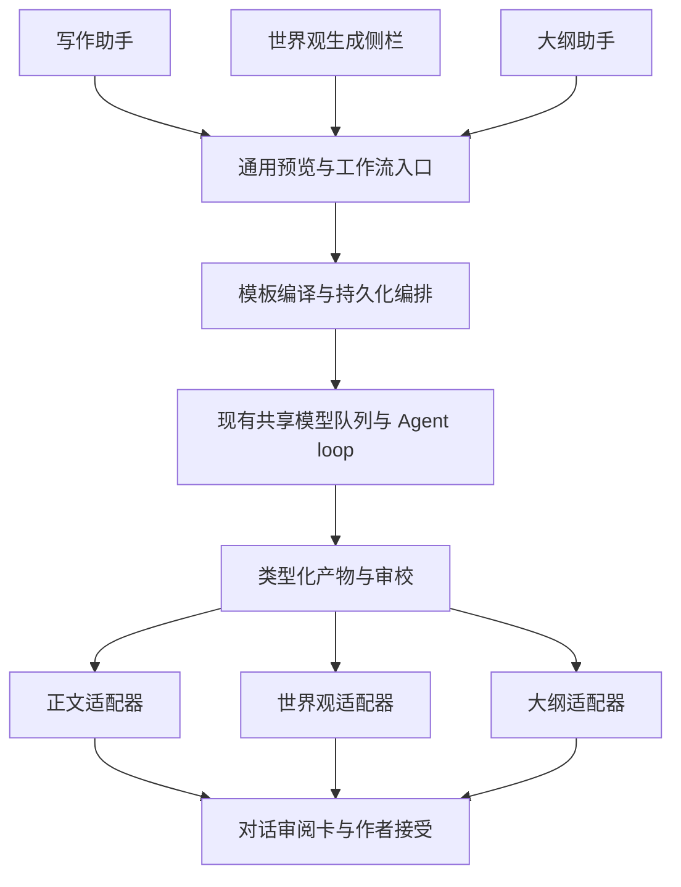

# 通用创作编排与助手入口设计

> **2026-11-05 重设计提示**：产物契约（JSON 提交工具、补全循环）、章纲确认闸门与审校汇总逻辑已被 [多 Agent 编排重设计](./多Agent编排重设计.md) 取代；节点现在直接以 Markdown 回复，依赖仅来自画布连线。下文保留为重设计前的记录，与新设计冲突处以重设计文档为准。

日期：2026-11-05  
状态：产品目标设计；通用任务、助手入口、结果保存与流程画布已实现，范围和限制见[实施说明](./MA-通用编排与流程画布实施.md)。本文中的建议字段和远期目标不等同于已交付 API。  
依据：主人提出将编排通用化，在写作助手输入区选择运行，并用于世界观、大纲生成。  
关联：[编排可靠性设计](./多Agent编排完善设计.md)、[MA 当前实现](./MA-多Agent工作流实施.md)、[要素当前实现](./ELM-创作要素实施.md)、[大纲当前实现](./OUTLINE-大纲实施.md)。

## 1. 产品结论与范围调整

编排升级为作品内通用的创作任务执行方式。作者在助手里选择任务目标与编排模板，输入要求、引用资料，然后直接运行；正文、世界观、总纲和故事事件使用相同的调度、审校、修订、人工确认与恢复机制。

本设计调整上一版“优先单章、从独立协作页面启动”的范围：通用任务契约、助手入口、世界观和大纲模板一起进入近期设计；单章流程作为其中一个预设。独立模板页继续负责创建与发布，原协作写作页用于查看历史和完整运行详情。

本轮覆盖正文写作、世界观生成或补全、故事总纲生成或修改、故事事件/章纲规划。其他人物、伏笔等要素通过相同适配方式扩展，不要求这次把全部分类重新做一遍。当前单类要素生成规则继续有效，多 Agent 不等于自动生成八类资料。

执行仍在本机后端，共用现有模型队列；截图中的选择器是运行入口。保持全局并发 1、活跃队列容量 32、作品写作占用、资料授权和模型上下文校验。自动修订按开关持续执行，不新增调用数、修订次数或执行期限限额。

## 2. 助手里的选择与发送

### 2.1 输入区组织

截图中模型选择和“单章写作”任务用途保留。增加独立的“执行方式”选择，避免把任务目标与执行方式塞入一个用途枚举。

```text
写作助手

输入创作要求，使用 @ 引用作品资料……

任务：世界观生成       执行：世界观构建与审校 ▾
默认模型：当前模型 ▾                 设置   发送
```

| 控件 | 选项或内容 | 行为 |
| --- | --- | --- |
| 任务目标 | 正文写作、选中改写、审校/聊天、世界观、故事总纲、事件规划 | 根据当前页面预选，作者可切换到该入口支持的任务 |
| 执行方式 | 直接生成、已发布且兼容的编排模板 | 直接生成沿用现有单 Agent 路径；选择模板后发送即创建父工作流 |
| 默认模型 | 已有模型配置 | 为未独立指定模型的节点提供默认值；预览列出实际使用模型 |
| 目标与资料 | 当前文档、新建目标、生成模式、@ 引用和其他授权资料 | 根据任务契约展示，不把当前打开的正文误当作世界观或总纲目标 |

紧凑布局中“执行：世界观构建与审校”已同时展示模板，不再额外叠加第四个常驻下拉框。窄屏换行，所有控件具有独立标签，可通过键盘操作。

模板列表显示名称、用途、简短阶段说明和发布版本。只有草稿或已失效依赖的模板不能启动；提供“管理编排”和“查看模板详情”。不兼容模板可隐藏或禁用并说明缺少的输入，不允许先发请求后悄悄退回单 Agent。

### 2.2 任务上下文与页面联动

| 入口 | 预选目标 | 没有章节时 |
| --- | --- | --- |
| 写作页助手 | 当前正文；未选正文时可选择新建章节 | 正文模板需显式支持新建章节；世界观和大纲模板仍可运行 |
| 基本信息中的世界观生成侧栏 | worldbuilding 分类，或当前世界观条目 | 正常运行，不创建占位章节 |
| 大纲助手 | 故事总纲、事件规划，或当前选中的大纲 | 正常新建总纲或事件候选，不要求先创建目标文档 |
| 原协作写作页 | 既有单章任务与运行详情 | 保留旧记录；新增任务逐步复用通用启动组件 |

写作助手切到“世界观”时，界面明确显示“生成到：世界与场景”；切到“故事总纲”时显示“生成到：故事总纲”。只有选择“修改已有条目”才绑定对应文档。任务切换不改变已打开编辑器的内容。

任务目标与执行方式可以记住作品/页面偏好，但每次发送重新校验目标、模板和权限；切换作品不沿用上一作品的文档或资料引用。选中改写的编排支持可后续开放，近期没有兼容模板时保留直接生成。

### 2.3 发送流程

1. 保存本次需要使用的正文、要素或大纲草稿；保存冲突时保留输入并要求处理。
2. 解析任务目标、模板版本、模型继承、@ 引用、资料策略与写入目标，取得预览。
3. 输入区展示当前模板、目标、实际模型和资料摘要；展开可检查节点顺序与授权范围。只有缺少必填项、版本变化或需要新增授权时要求处理，不增加每次发送的重复确认弹窗。
4. 用预览 hash、稳定的客户端请求 ID 和幂等键创建父工作流；预览变化时重新展示差异，不能静默更换模板、资料或目标。
5. 对话中插入一张工作流运行卡，展示阶段、产物、审校问题和作者操作；查看详情再进入完整页面。

所有节点都有独立有效模型时，不因未选默认模型禁用发送；存在继承节点却缺少默认模型时定位相应节点。模型选择只影响新任务，不覆盖已冻结的运行配置。

## 3. 通用编排核心与业务适配器

核心调度依赖节点和类型化产物，不依赖“当前章节”“最新正文”或单一正文提议。任务适配器负责业务输入、验证与结果保存。



| 责任 | 通用核心 | 任务适配器 |
| --- | --- | --- |
| 输入 | 冻结快照、依赖、实际输入绑定 | 识别目标、业务模式、资料选择与必需参数 |
| 模板 | 类型兼容、依赖无环、确认点与修订策略 | 注册可用的业务产物契约和预设 |
| 执行 | 父子运行、队列、取消、检查点、重试与 SSE | 给节点补入业务要求和允许动作 |
| 审校 | 批次、有效报告、严重程度与人工决定 | 检查正文、结构化字段、总纲或事件的具体规则 |
| 产物 | 不可变包络、血缘、失效与来源 | 校验目标类型、字段锁定、引用、关联和大小 |
| 保存 | 幂等接受与运行状态对账 | 生成对应候选，校验基准并事务保存到正确业务对象 |

原 `plan/draft/review/analysis` 能力和单章模板仍可读。新版增加通用 `generate` 能力，声明可生成的已注册产物类型；`review` 与 `analysis` 可消费声明兼容的产物。修订节点绑定具备对应生成能力的角色。旧 plan/draft 通过适配保持现有输出，不能只改角色名称便让正文产物冒充世界观。

不要求用户编写 JSON Schema。模板编辑器按“生成、审校、分析、人工确认”配置节点，能力与业务契约由系统注册；策划和润色属于生成节点的职责预设。外部脚本和任意模型返回结构不参与调度。

## 4. 任务、目标与产物契约

以下是目标字段方案。实际 shared schema 已加入 taskType、sessionId、可空目标、mode 等字段；尚未引入显式 schemaVersion=2 或下文全部嵌套契约。调用请以 shared schema 和实施说明为准，旧请求及旧运行保持兼容。

### 4.1 运行输入

| 字段 | 含义 |
| --- | --- |
| `projectId`、`sessionId` | 作品与发起会话；会话用于展示和恢复，不将其全部历史自动授权给角色 |
| `taskType` | 已注册的正文写作、世界观生成、总纲生成或事件规划任务 |
| `target` | 区分新建或修改的业务目标；修改必须指定 documentId 与 baseVersionId，新建不要求已有文档 |
| `parameters` | 目标分类、补全/替代/提取模式、目标数量、规划范围等，由任务 schema 校验 |
| `templateVersionId` | 不可变模板版本；发布清单声明支持的 taskType、输入和最终输出 |
| `sourceSnapshot`、`executionSnapshot` | 授权资料与执行配置，继续按可靠性设计分别冻结 |
| `expectedPreviewHash` | 本次任务预览校验；完整覆盖目标、参数、授权范围及模板 |

`target` 使用判别联合，不能简单把所有必填字段改为可空。正文修改、世界观修改和总纲修改各自验证同作品及正确文档类型；新建世界观、新建总纲、事件批次只要求作品和必要业务参数。

世界观的 create/fill/replace/extract 语义与现有要素模块一致：fill 保留已有非空内容，replace 仅替代授权目标且保留锁定字段，extract 必须引用来源。已填写的八类要素可以作为参考，默认保持现有生成入口的资料策略并在预览说明；参考范围不等于修改范围。正文入口继续遵守正文顺序与未来规划授权。

### 4.2 产物与最终输出

| 业务产物 | 内容与校验 | 作者接受后的去向 |
| --- | --- | --- |
| `chapter_draft` | 完整 Markdown 正文；新建需标题、分卷及关联参数 | 修改目标正文或创建明确授权的新章节 |
| `element_candidates` | 具有 tempId、分类、标题、content、element data 的结构化条目；近期世界观任务只允许 worldbuilding | 世界与场景条目及对应版本 |
| `master_outline_candidate` | 一份完整故事总纲、标题、依据与待决事项 | 新建 master_outline，或形成该目标的新版本 |
| `outline_event_batch` | 有序故事事件/章纲集合，保留时间、摘要、完整内容和业务关联 | 现有事件/章纲目录，不自动创建小说正文 |
| `review_report` v2 | 绑定目标产物 ID 集合、快照与审校批次；问题定位到条目、字段或正文片段 | 只用于审阅与推进，不直接保存业务文档 |
| `analysis_note` | 有来源的辅助建议与待决事项 | 供指定节点读取 |

该表为任务层目标结构，现有 `chapter_draft` 不能直接提交新增章节参数；新增与修改正文应分别由适配器转换到对应候选。可复用现有要素和大纲 schema 的字段校验，但不要求原业务表立刻支持工作流来源。

编排输出显式声明 `outputs`：每个输出引用具体节点、产物类型、保存适配器和目标。发布时校验匹配，不再以“最后一个 chapter_draft”硬编码为所有任务的最终结果。服务端注册保存适配器，模板和模型不得指定任意表名、路径或写入动作。

多份产物审校须固定完整集合与各自 hash；集合中任一成员或结构化字段变化，相关报告失效。问题锚点支持“世界观条目/fields.rules”“总纲段落”“事件 tempId”，不能强制所有问题都在正文里寻找 quote。

持续修订的无有效变化判断也按产物契约实现：比较正文内容、世界观可保存字段、总纲内容或有序事件集合；忽略运行 ID、时间和修订说明，保留具有业务含义的条目顺序。结构化结果不能因说明变化而假装完成修复，也不能只比较 Markdown 而漏掉字段变化。继续使用自动修订开关，不按修订轮数停止。

## 5. 首批可运行模板

| 模板 | 流程 | 最终输出与确认 |
| --- | --- | --- |
| 单章协作写作 | 章纲准备 → 可选确认 → 初稿/润色 → 一致性与叙事审校 → 定向修订复审 | 一份正文候选；作者接受后写入目标或新建章节 |
| 世界观构建与审校 | 资料梳理 → 世界观设计 → 规则/代价/禁忌一致性审校 → 冲突修订复审 | worldbuilding 分类的结构化候选，可逐条审阅；未接受不成为正式设定 |
| 故事总纲规划 | 创意与人物目标分析 → 总纲设计 → 人物弧线/主线因果审校 → 修订复审 | 一份故事总纲；与已有总纲并存或修改明确目标，不将新候选覆盖当前正文 |
| 故事事件规划 | 选择总纲与范围 → 事件拆分 → 时间线/承接审校 → 修订复审 | 有序事件/章纲批次；未创建正文也可运行 |

缺少创意、人物目标等关键输入时，先产生具体待决事项，在对话卡中补充后继续；不为了满足“必须有正文”而生成无关章节。

“世界观 → 总纲 → 事件”可在后续作为组合模板：模板显式声明每个目标与确认点；默认世界观确认后再推进总纲，总纲确认后再拆事件。作者可在预览中明确允许下游使用本次未接受候选，所有结果仍标记为候选，依赖修改时下游失效。这不恢复原先无差别生成八类要素的操作。

## 6. 统一审阅与按类型保存

对话里的运行卡承担进度、待决问题和结果审阅，按产物类型渲染正文差异、世界观字段、总纲 Markdown 或事件列表。聊天说明与结构化结果分开展示；不能将普通助手回复转换成正式正文或业务候选。

| 结果 | 接受规则 |
| --- | --- |
| 修改已有正文/总纲/世界观 | 校验明确目标、基准版本、字段锁定和候选 revision；冲突保留双方内容，作者合并后重新审校 |
| 新建世界观/总纲 | 不要求预建空文档；按候选稳定身份幂等创建，重复点击返回已创建结果 |
| 事件批次 | 沿用目录和关联校验；关联删除或变更时提示处理；默认整批事务接受，失败整批回滚 |
| 多条世界观 | 可逐条接受；存在临时候选引用时先接受依赖，或同批事务替换 tempId；拒绝悬空引用 |

运行完成与结果已保存分别记录：`executionStatus` 表示执行进度，`reviewStatus` 表示 pending/partially_accepted/accepted/rejected/processed 等审阅情况。不要让逐条采用一个结果就把整个流程误标为全部接受；旧单章 `status/outcome` 通过兼容映射展示。

候选接受由适配器在一个本地事务内写业务版本、保存已接受结果映射、更新候选审阅状态并写事件。旧要素、正文和大纲接受服务需抽取可复用的事务函数或新增受控来源，不能简单串调几个 HTTP 请求假定原子性。运行与候选必须能相互定位，同一候选只形成一份接受记录。

同一工作流中的多个保存目标明确分为接受组：一组成功或回滚，组间不假装具有全局原子性。部分接受后，未接受结果修改只影响其依赖后继；已接受的正式版本保留，不能撤回历史冒充未发生。若下游仍依赖旧候选，则展示差异并失效重跑。

候选转正式资料后保存 ID/版本映射；仅当采用内容与依赖候选完全一致时允许重绑定来源而不重新调用模型。作者在采用前改了字段或内容，必须按新 hash 失效下游，不能只替换 ID 后继续。

## 7. 会话、运行与控制的一致性

一条用户请求关联一个父工作流，父工作流关联多个节点运行；子节点不伪装成用户轮流发起的独立聊天，也不各自触发普通正文提议。会话里显示一张可展开的持续更新卡片，节点详情按需打开。

- 创建父流程与会话绑定应在同一事务，或通过持久化请求 ID 幂等补齐；断网重发不能创建第二个流程。
- 刷新和切页从服务端恢复父工作流与运行卡；历史记录保留本次任务、目标、模板与发布版本，不按当前控件重新解释旧请求。
- 父流程运行时发送按钮可停止该流程；暂停、恢复、反馈、编辑和接受均通过父流程入口。不能只取消当前子节点却留下父编排继续推进。
- 运行中改变下拉选择只影响下一条请求；有待处理流程时展示其入口，同作品新生成遵守现有占用规则，处理意见通过运行卡提交。
- 普通讨论可以保留现有不写入的聊天能力；与工作流并存时只读取已授权快照，不能借聊天工具写同作品或修改流程产物。
- 上游变化、审校屏障、无有效变化、迟到结果和重启恢复复用可靠性设计，并从正文特例推广到所有声明的结果。

世界观生成任务、普通写作、大纲生成和通用编排统一检查作品写入占用，共用底层模型队列。适配器提交候选不应再启动旧模块的独立生成任务或二次排队，避免嵌套调度、重复模型调用与占用死锁。

## 8. 接口演进与旧功能迁移

建议保留现有工作流资源路径，以显式 v2 schema 扩展预览、启动、详情与决策契约。模板声明支持的 taskType、输入参数 schema、节点产物与 outputs；客户端按兼容性筛选。具体协议形态在实现时确定，当前 `/workflows` 仍要求章节目标，不能直接调用它运行世界观。

| 当前单章假设 | 通用目标 | 兼容策略 |
| --- | --- | --- |
| 必填 targetDocumentId/baseVersionId，目标必须 chapter | taskType + 判别 target | v1 输入映射为 chapter_write/update；v2 新建目标不伪造文档 |
| latestDraftId 与 reviewedArtifactId | 具名输出与审校目标集合 | 保留旧字段读取；v2 不靠正文专用字段推进 |
| plan/draft/review/revise 固定顺序 | 已注册能力、输入输出与依赖编译 | 旧模板按单章规则编译，新模板按声明契约校验 |
| 最终固定创建正文提议 | 保存适配器与接受组 | 正文继续复用原语义，世界观与大纲接入各自业务校验 |
| 独立协作页面发起 | 助手选择模板、统一运行卡 | 先保留旧页面和历史，抽取共享启动与详情组件 |

改造涉及当前 `WritingPanel`、`WorkflowStudio`、`ElementPanel`、shared workflow/artifact schema、WorkflowService，以及正文、要素和大纲候选的接受逻辑。只共享编排与审阅组件，不重写各自编辑器。

世界观与大纲的现有直接生成保持可用，优先让新增编排走通用入口；验证同一任务的资料、锁定、版本及接受语义一致后，再考虑将直接生成实现为单节点模板。旧表、旧 run 和已接受版本保留，通过新迁移扩展数据，不能原地修改已执行迁移。

## 9. 实施顺序与验收

| 阶段 | 交付 | 关键验收 |
| --- | --- | --- |
| G1 通用契约 | task/target、生成能力、类型化输出、适配器与旧单章映射 | 无章节可预览世界观/总纲；旧运行可读；类型不匹配在调用前拒绝 |
| G2 助手入口 | 执行方式选择、目标摘要、发送编排与对话运行卡 | 不离开助手完成启动、补充意见、暂停恢复和结果审阅；刷新无重复任务 |
| G3 世界观闭环 | 世界观构建/审校/修订模板、字段锁定与逐项接受 | 只产生 worldbuilding 候选；参考其他要素但不修改；接受后出现在正确分类 |
| G4 大纲闭环 | 总纲与事件模板、目录及关联保存 | 新建不要求正文；修改目标正确；事件按序且幂等保存；不误创建正文章节 |
| G5 可靠性与迁移 | 通用依赖屏障、快照、失效、恢复、业务占用与兼容 | 跨页面和断线恢复一致；取消不复活；版本冲突、批次回滚及部分接受正确 |

G1 的类型、血缘、事务边界应与编排可靠性设计同步定义；G3/G4 的结果接受不能等到 G5 才补版本和幂等校验。世界观和大纲属于本轮通用化的近期目标，不再依赖先实现连续多章或整书自动写作。

验收至少包含：

1. 空作品仅输入创意，在助手选择世界观模板完成生成、审校、修订和采用，全程不创建占位章节。
2. 当前打开正文时切换世界观任务，明确显示世界观目标，正文 hash 与版本不变。
3. 采用世界观后选择总纲模板；预览列出已确认世界观，接受后创建正确总纲。
4. 从总纲生成多条故事事件，默认整批接受有序落库；重复确认不重复创建，冲突整批回滚。
5. 两个审校节点查看同一组世界观字段；任一字段或条目改变后旧报告不能让新候选通过。
6. fill、replace、extract 分别遵守补全、锁定及来源规则；参考八类资料仍只能修改目标分类。
7. 模板不兼容、缺少继承模型或 target 错类型时，发送前定位原因，不静默切换执行方式。
8. 刷新、重发和切页恢复同一父流程；停止取消整个编排，子运行完成不能自动创建新结果。
9. 部分采用世界观后编辑未采用条目，引用有效；已保存版本不回退，过时下游必须重新审校。
10. 历史单章流程、现有直接生成、要素采用和大纲候选仍可查看和使用，不重复计费或保存。

本次只完善设计，没有执行模型请求，也没有运行应用测试。后续实现需分别验证契约、事务和浏览器完整流程，真实创作质量与实际用量另行评估。

## 追加：可视化流程编辑

工作流模板默认使用类似 Dify 的节点画布，支持拖动、连线与节点侧栏配置。连线表示实际依赖，位置单独持久化；运行按依赖排序。自动修订反馈在图中以系统虚线回路表示。继续保留列表编辑；条件脚本与完整 Dify 工具生态不在本轮范围。详细契约见[实施说明](./MA-通用编排与流程画布实施.md)。
